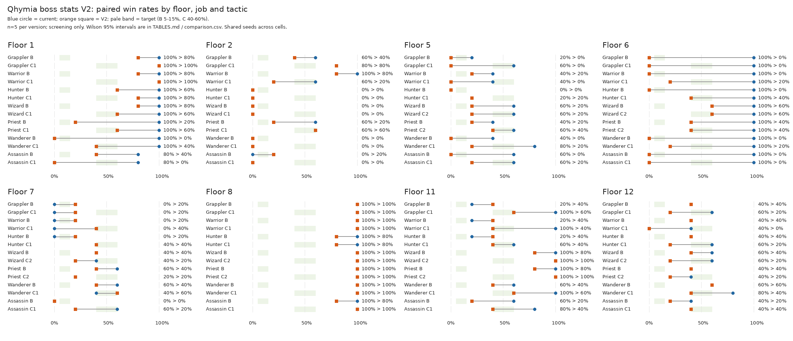

# ステップ5-C：ボス能力値Ver.2の全変更階層比較

実施日：2026-11-18 JST。ブランチ`feature/boss-balance-stage5c`、開始HEAD`68c5002`。**ユーザー指定Ver.2の評価のみで、正式実装は行っていない。** 前半の`BOSS_BALANCE_STAGE5C.md`・`balance_stage5c/`など、既存の作業と未追跡ファイルを保持した。

**Ver.2の一括採用は保留。** 1/8/11階は過度な高勝率を下げる方向の証拠があるが、8階は依然ほぼ全勝、11階は魔法Cが全勝のまま。5/6/12階は攻撃重視Cまで下がり、7階は物理の一部で改善する一方で暗殺者・魔法職の課題が残る。各5戦なので、以下の採用判断は候補の取扱いであり最終難易度の認定ではない。

## 測定結果・条件

**224条件・1,120戦すべて完了。戦闘93.837秒、DB/条件準備込み最終進捗109.8秒、破棄込みランナー実時間109.995秒。** 例外・引分・1000ループ上限・欠測は0。完全条件224、不完全条件0、未測定条件0。詳細224件は各条件の先頭seedの内訳で、1,120戦へ再加算しない。

計画は8階層×7職業×2戦術×旧/新×5戦。5-A/5-Bの条件別実測に新ボス長期化係数1.5と安全倍率1.5を掛け、**戦闘238.844秒＋準備15秒＝253.844秒**と実行前に予測した。2/11階は同一の継承・戦術の旧実測がないため旧予備Bの時間×1.5、5階C2はC1の時間×1.25を参考に使う。これは時間見積りだけで、過去の勝率を新条件へ流用したものではない。予測が270秒を超える場合は全224条件を残して試行数を均等に減らす設計だが、今回は削減なし。

新seedは**90361118〜90361122**。旧Stage3〜5-C前半の195種類のseedと非重複を確認。旧/新・候補間で全5seedを揃え、旧/新を隣接して測定した。270秒以降の新規戦闘開始停止を既存ランナーで維持した。

キャラクターは5-Aの`recommendation_eligible`なprofileを再利用。種族・職業・Lv/回帰・素値/属性値・装備/強化・永久習得/取得履歴・開始HP/MP/STを固定する。種族はヒューマン、育成seed20261116。Bと物理Cは5-A、魔法職は自由/アンチ/ジャッジの使用資格を全部満たすときだけ5-BのC2を使う。**1/2階の魔法職はC1、5/6/7/8/11/12階はC2**。無資格のC2やC3は与えない。ボスの技能列/使用予算も旧新で共通。

|階|評価条件の要点|
|---|---|
|1|Lv20・0回帰・装備なし。初心者向けの固定到達例|
|2|Lv70・0回帰・装備なし。C2の継承資格なし|
|5|Lv80・10回帰・F+3・戦闘力約2,150〜2,160|
|6|20回帰・戦闘力5,000の職業別到達例|
|7|F+5・戦闘力約13,380|
|8|F+5・戦闘力約26,380|
|11|F+5・戦闘力63,382|
|12|F+5・戦闘力83,382|

後半の数百回帰を含む値は従来の数値上の到達例で、実際の素材/Q・育成時間の妥当性を今回検証していない。正式推奨回帰数へ昇格させない。

## 隔離DBとの全フィールド照合

旧値は現行migrationから構築した専用PostgreSQLテストDBの`Enemy`から取得した。全12体のHP/MP/STR/INT/DEX/AGI/VIT/LUK/ST、名前・属性をユーザー表と照合し、**変更階層は想定の1/2/5/6/7/8/11/12階と完全一致**。3/4/9/10階は数値変更がないため戦闘を再測定していない。属性・STは全階層で一致。既存技能列も現行migrationと一致し、変更していない。

|階|実際の変更点（旧→Ver.2）|
|---|---|
|1|HP64→80、STR11→15、AGI12→15、VIT7→10|
|2|HP356→390、STR29→30、AGI68→75|
|5|HP3,600→4,600、STR240→300、INT145→125、AGI88→100、VIT170→150|
|6|MP2,400→500、STR350→999、AGI145→150、VIT480→530|
|7|INT1,600→2,000、VIT1,300→750|
|8|HP50,000→59,000、STR950→1,286、INT470→670、AGI180→900|
|11|INT5,400→6,000、AGI1,950→2,150、LUK2,300→7,777|
|12|HP156,924→166,666、MP56,000→66,666、STR5,600→6,666、INT5,600→6,666|

表の全数値は[新規ランナー](BALANCE_STAGE5C_V2_RUN.py)へ完全値として保持し、メモリ上のコピーにだけ設定する。[照合結果](balance_stage5c_v2/screen_confirmed/catalog_comparison.json)には旧/新全12体と差分を保存した。想定外の差異・属性/ST不一致・技能不一致を検出した場合は戦闘開始前に停止する契約を検証済み。今回その差異はなかった。

## 全職業の勝率比較表・グラフ

要求された**「階層 / 職業 / 戦術 / 旧勝率 / 新勝率 / 差 / 評価」112行の表**は、[全階層・全7職の比較表](balance_stage5c_v2/analysis/TABLES.md)に保存した。各行に勝/試行・Wilson95%・差のポイント数・完了状態を記載している。

- [旧→新の勝率グラフ（PNG）](balance_stage5c_v2/analysis/win_rate_comparison.png) / [拡大・共有用SVG](balance_stage5c_v2/analysis/win_rate_comparison.svg)
- [対応比較CSV](balance_stage5c_v2/analysis/comparison.csv)：旧新の率/区間・目標差・勝敗反転数
- [224条件の全指標CSV](balance_stage5c_v2/analysis/conditions.csv) / [完全JSON](balance_stage5c_v2/analysis/results.json)
- [階層別の職業間最大差CSV](balance_stage5c_v2/analysis/floors.csv)



グラフの青丸が旧値、橙四角がVer.2、緑帯がB5〜15%・C40〜60%。区間は表で確認する。図の英語職業名は順にGrappler＝拳闘士、Warrior＝重戦士、Hunter＝狩人、Wizard＝ウィザード、Priest＝プリースト、Wanderer＝放浪人、Assassin＝暗殺者。

5戦のWilson95%は0勝0〜43.4%、1勝3.6〜62.4%、2勝11.8〜76.9%、3勝23.1〜88.2%、4勝37.6〜96.4%、5勝56.6〜100%。**5戦の点推定は20ポイント刻みなので、Bの5〜15%帯への適合を点推定だけでは認定できない。** 比較表の評価欄は目標10%/50%への絶対距離の変化だけを表し、有意差や採用判定ではない。

### 階層別の記述合計と職業間格差

合計は各7職×5戦の記述値。共通seedによる相関があるため、独立35試行として区間計算・採用判断に使わない。最大差は各戦術の7職間の最大勝率−最小勝率。

|階|B 旧→新 勝/35|C 旧→新 勝/35|B職業間最大差 旧→新|C職業間最大差 旧→新|候補の判断|
|---|---|---|---|---|---|
|1|34→18|34→22|20→80pt|20→100pt|再調整。初心者の職業差が拡大|
|2|11→8|10→8|100→80pt|80→80pt|保留。既存の低勝率職が残る|
|5|13→3|19→6|60→20pt|60→40pt|再調整。B合計だけで採用しない|
|6|35→5|35→9|0→60pt|0→60pt|再調整。物理B全敗、Cも低下|
|7|8→9|10→11|60→40pt|60→40pt|部分改善だが保留|
|8|35→33|35→34|0→20pt|0→20pt|再調整。依然高勝率|
|11|19→17|32→22|80→60pt|40→60pt|部分改善だが保留。魔法C全勝|
|12|16→14|19→8|20→40pt|40→40pt|再調整。B/Cの目標差が逆方向|

## 1階：初心者の生存率と職業差

改善は、旧来ほぼ全勝だった状態から勝敗が動き、ボスの攻撃機会が増えたこと。14条件等重み平均で、ボス行動4.39→6.26、被ダメージ23.5→52.8、決着7.64→8.84ループ。最初のプレイヤー行動より前にボスが動いた戦闘は0/70→30/70になった。

一方、固定のLv20・装備なし条件での最終生存は**68/70→40/70**。職業別Bの新勝数は拳4・重4・狩3・ウ4・プ1・放0・暗2、Cは順に5・5・4・3・3・2・0（各5戦）。放浪人Bと暗殺者Cは全敗になる一方、拳闘士/重戦士Cは全勝が残る。Bの職業間差80pt、C100ptへ拡大し、初期職業による負担を平均で隠せない。

変化が小さいのは拳闘士/重戦士Cの勝数だが、重戦士Cでも被ダメージ16→52と増えており、戦闘内容まで不変ではない。目標はBの新点推定0〜80%、C0〜100%と職業差が大きい。

**次の数値候補：新HP80/AGI15/VIT10を固定しSTR12/13/15を単独比較する案。** 生存の境界を探す目的で、現時点では未測定。VIT8/9も代案だが同時変更せず、強い職業が再び全勝するリスクも職業別に確認する。Ver.2のそのまま採用は勧めない。

## 2階：高速型の行動機会と低勝率職

ボスの平均行動8.36→9.36、プレイヤー初動前のボス行動1.29→1.57、決着10.66→12.01ループ。全140戦でボスが先に動き、高速型という特徴を維持している。先制回数は「プレイヤーが最初に行動する前のボスのゲージ行動数」として記録した。

Bの新勝数は拳2・重4・狩0・ウ0・プ1・放0・暗1、Cは4・1・0・0・3・0・0。重戦士B80%、拳闘士C80%がある一方、狩人/ウィザード/放浪人は旧新B/Cすべて全敗。Cの職業最大差80ptは変わらない。さらに強化する一律案では低勝率側を改善できない。

拳闘士CとプリーストCは旧新の勝数が同じでも、それぞれ**旧勝→新負1件と旧負→新勝1件**があり、同じ戦闘が維持されたわけではない。暗殺者Bは強化後に0→1勝という逆転もあり、同seedでも行動順変更で乱数消費が変わることを示す。

**判断は保留。次の境界候補は新HP390/STR30を固定してAGI68/70/75。** 先制と生存を分けて比較する。HP356/370/390の単独比較は代案。いずれも未測定で、低勝率職の装備なし固定評価経路も併せて見直す必要がある。B22.9%/C22.9%という記述平均だけで目標到達としない。

## 5階：防御低下による相殺より死亡が早まる

F+3・同一育成を固定した。VIT170→150は物理1ヒットの防御減算を10軽くし、INT145→125は通常魔法1ヒットを6軽くする。他方HP+1,000、STR+60、AGI+12が同時に入るため、今回の比較だけでは各変更の寄与を分離できない。

Bは13→3/35勝となり記述平均8.6%に近づくが、Cは19→6/35勝、**54.3%→17.1%**と遠ざかった。新Bは拳0・重1・狩0・ウ1・プ1・放0・暗0、Cは0・0・1・1・2・1・1。拳闘士/重戦士Cは全敗へ移行し、プリーストC以外はC帯の点推定に届かない。

全14条件平均のプレイヤー行動9.16→7.24、決着11.86→9.64ループ、被ダメージ736→794、与ダメージ3,040→2,640。HPが増えたのに決着が早いのは、攻略が速くなったと解釈せず、早い敗北を確認する。狩人C1/5は旧新で同じだが、全体では防御低下が相殺し切れていない。

**次の候補は新値を基準にSTR240/270/300の単独比較。** Bを意図的に弱くしてCとの差を作らず、B/Cの生存と攻撃機会を再評価する。防御低下・F+3経路は検討に残すが、現Ver.2は再調整対象。

## 6階：STR999は生存閾値を大きく超える

現行のリヴァイアサンは**スキル列が空で通常攻撃専用**。旧MP2,400→最終2,400、新MP500→最終500で、全戦のMP消費・MP不足・スキル成功は0。今回のMP変更に行動上の効果はない。独自の魔法・スキルを補完していない。

プレイヤーHPは例として拳闘士1,100・ウィザード1,160・プリースト1,213。STR350→999に加えVIT/AGIも増え、新ボスの平均直接攻撃行動は3.51→2.24へ減っても、被ダメージ457→1,178、プレイヤー行動10.51→6.44、決着13.61→8.23ループとなった。少ない攻撃でプレイヤーを倒している。

旧値では全職B/C各5勝。新Bは物理5職すべて0/5、ウィザード3/5・プリースト2/5。新Cは拳0・重1・狩2・ウ3・プ2・放1・暗0。魔法職Cは点推定40〜60%に残るが、物理側を犠牲にして平均を正常扱いできない。B/C双方の職業最大差が0→60ptへ広がった。

**次に優先する数値はSTR600/750/900。** 新HP9,600・VIT530・AGI150・MP500等を固定して1能力ずつ測る未測定候補。MPを増減してこの難易度差を直す案には根拠がない。Ver.2は再調整とし、STR999の正式採用は保留する。

## 7階：VIT低下の利点とINT強化の負荷

INT1,600→2,000はステラの基礎値を1ヒット280増やし、ボス魔法防御の減算も1ヒット120増やす。VIT1,300→750はプレイヤー物理攻撃の減算を1ヒット275軽くする。属性・疲労・バフ・命中・クリティカルを経た最終値は別で、単純な加算を実ダメージと同一視しない。

拳闘士/重戦士/狩人Bは各0→1/5勝、拳闘士C0→1・重戦士C0→2となり、物理側に攻略改善の兆候がある。狩人Cは2/5のまま。反対に暗殺者Bは0/5のまま、C3→1/5。放浪人B3→2・C2→3、ウィザードB2→2・C2は2→1、プリーストB3→2・C2は1→1。

職業最大差はB/Cとも60→40ptへ縮むが、新Cの点推定20〜60%のうち、拳闘士・魔法2職・暗殺者は20%。Bは0〜40%で、両目標を全職で満たしたとはいえない。

全14条件平均で決着13.94→11.13ループ、プレイヤー行動10.43→8.36。被毒ダメージ655→451は生存/行動時間短縮も含むため、状態異常耐性の改善とはしない。ステラの実被ダメージ平均は3,489→3,811。魔法Bではウィザード3,109→3,645、プリースト3,087→3,795へ増え、VIT低下では直接防げない負荷がある。

**部分改善だが採用保留。次の候補はVIT750を固定してINT1,700/1,800/2,000。** 旧来のINT1,280への一律低減へ戻す前提ではなく、今回の新しい物理防御条件で相殺の境界を調べる案。魔法Bが既に40%なので、単純に弱めれば全目標が揃うとは仮定しない。

## 8階：戦闘内容は改善するが高勝率は残る

旧値は全7職B/C各5/5。新値は狩人B/C、暗殺者Bが各4/5になり、ほかは各5/5。**B33/35・C34/35**で、全職100%という文字どおりの状態は崩れたが、目標への隔たりは依然大きい。Bは目標より+70〜90pt、Cは+30〜50pt。

全14条件平均のボス行動0.63→7.41、直接攻撃行動0.06→3.00、補助行動0.47→3.90、プレイヤー被ダメージ51→3,967、決着13.81→18.87ループ。AGI増加は行動機会を作り、STR増加と合わせて実ダメージも増えた。ボスの与ダメージはプレイヤー実HP減少で、補助行動を攻撃回数へ加えていない。高勝率でも無効果な変更ではない。

**次のHP候補は70,000 / 80,000 / 100,000（ほかは今回の新値を固定）。** すべて未測定。前半のHP100,000/200,000はAGI180・STR950が対照であり、今回のAGI900・STR1,286へそのまま結果を移せない。前半で出た20万のスキル枯渇・毒職の優位も監視し、いきなり大幅HP増加を正式採用しない。Ver.2は次の比較基準として残すが再調整が必要。

## 11階：LUKは魔法クリティカルや状態異常率を直接増やさない

現行の物理クリティカル率は`5 + 45 × 攻撃側LUK / (攻撃側LUK + 防御側LUK)`、クリティカル倍率は攻撃側LUKを参照する。開始時の拳闘士LUK約5,171.55を例にすると、ボスLUK2,300→7,777によりプレイヤーの物理クリティカル率は**約36.1%→23.0%**、ボス通常物理の率は約18.9%→32.0%。疲労/バフ中は現在の有効LUKで再計算される。

ボス技能はジャッジ・ステラ・シールド・浄化・アンチで、魔法攻撃には現行コード上クリティカルがない。LUK増加はボスの魔法火力や麻痺率を直接増やさない。麻痺付与50%・麻痺skip50%などの既存判定は固定で、LUK耐性を創作しない。LUK参照の真拳や核心はセレスティアの技能列にはない。浄化の未完成な防止効果も追加しない。

実際の14条件平均でプレイヤーのクリティカルヒットイベントは1.80→1.31、ボスは0.13→0.24。回数はログから数えた実ヒット数で、試行率そのものではなく、攻撃/生存機会の変化も含む。主な被ダメージ増加は魔法で、ステラ平均7,373→9,757、全被ダメージ17,348→20,712。INT/AGIも同時変更されているため、すべてをLUK単独の因果効果にはしない。

新しい物理5職Cは拳3・重2・狩2・放3・暗2/5で、点推定40〜60%へ近づいた。一方、魔法C2は両職5/5のまま、魔法Bも各4/5。物理Bは順に2・2・2・2・1/5でB目標を上回る。Cの職業最大差は40→60ptへ拡大し、魔法職と物理職の差を残す。

**部分改善だが採用保留。LUKをさらに上げる案は優先しない。** 次に能力値の境界を見るならLUK7,777等を固定したINT6,000/6,300/6,600の単独比較を候補とするが、魔法Cを下げる前に物理Cが崩れる可能性を確認するための案で、強化推奨値ではない。1能力で両者を揃えられる根拠はまだない。

## 12階：火力強化でCがBを下回る

新Bの勝数は拳2・重2・狩2・ウ2・プ2・放3・暗1/5で、旧からの変化はウィザードと暗殺者が各−1勝だけ。新Cは1・0・1・1・1・2・2/5となり、旧から拳/重/狩/ウ/放が各−2、プが−1、暗は同数。B14/35に対しC8/35で、必要なB10%・C50%の関係と逆方向。

全14条件平均で被ダメージ25,626→29,234、プレイヤー行動8.54→7.33、決着11.10→9.81ループ。Bの平均回復量は大きく変わらないが、回復なしCが攻撃を積む前に倒されやすくなっている。物理職だけでなく、ウィザードC2も3→1/5、プリーストC2も2→1/5へ低下した。魔法職のINTだけでは物理スキルを防げず、INT増加はプレイヤーの魔法攻撃への防御にも働く。

ボスのMP不足は旧新とも0。平均消費は旧29.2、新23.6で、MP56,000→66,666が行動上の制約を解消した戦闘はない。消費減少は短期決着等の結果であり、MP強化の成功と扱わない。

**再調整を優先。次はSTR6,000 / 6,300 / 6,666を単独比較し、別系列でINT6,000 / 6,300 / 6,666を調べる候補。** 新HP/MP等は固定し、同時に2能力を変えない。Cを無理に強化したりBの回復を削ったりせず、ボスの攻撃負荷と防御の作用を分離する。現Ver.2の正式反映は保留する。

## 次の調整案の優先順位

|優先|対象|次の数値案（未測定）|判断基準|
|---|---|---|---|
|1|8階|新値基準HP70,000/80,000/100,000|全職高勝率を下げつつ、疲労/技能枯渇/毒の差を拡大しすぎない|
|2|6階|新値基準STR600/750/900|物理B/Cの早期死亡を減らし、魔法Bの高勝率化も確認|
|2|12階|STR6,000/6,300/6,666、別比較でINT6,000/6,300/6,666|CがBを下回る原因を分離。MP増加で直そうとしない|
|3|1階|STR12/13/15、代案VIT8/9/10|初心者の職業別生存を確認し、特定職全敗と全勝の同居を緩和|
|3|5階|STR240/270/300|F+3のC攻略機会を戻せるか。B合計8.6%だけで採用しない|
|4|7階|VIT750固定、INT1,700/1,800/2,000|物理改善と魔法攻撃負荷を両方見る|
|4|2階|AGI68/70/75、代案HP356/370/390|低勝率職と先制行動の関係。強い職を平均に混ぜて正常扱いしない|
|4|11階|LUK据置き、必要ならINT6,000/6,300/6,600|魔法C全勝と物理C40〜60%の両立限界を確認|

**現時点で正式採用を確定する階層・能力値はない。** 上記は次の有限測定計画を作るための候補で、今回追加測定・正式保存はしていない。一括調整の結果だけでは単一能力の効果を断定できないため、次回は必要な軸を絞って同一seedの比較を計画する。300/1,000戦への拡大も実施していない。

## 記録した指標・検証上の限界

条件ごとに勝敗/試行・Wilson95%・目標との差、プレイヤー/ボス行動、通常攻撃・技能成功/発動失敗/MP不足、与被ダメージの種類別内訳、技能別ダメージ、回復、最終HP/MP/ST、状態異常の付与/継続/解除とskip、決着ループ、先制行動、クリティカル実ヒット数を保存した。旧→新の勝敗反転は112比較の全てで数え、職業最大差は階層・B/C別に記録した。

与被ダメージは要求ダメージではなく実HP変化で、自傷を分離し、毒/反撃/反射/回復を別カテゴリで扱う。死にやすい新条件で総被ダメージや行動数が小さくなる場合があるため、強化が効かなかったとは解釈しない。全戦でHP台帳、ST消費、ゲージ100消費、1ループ1人1行動の既存観測契約を検証した。同時HP0は今回0件。

少数5seed・固定育成seed/種族/装備/継承プールのため、職業間の差や逆転が別seedで変わる可能性がある。複数条件で同じseedを使い、相関がある。多重比較補正はしていない。旧新の率の差についてWilson区間を単純減算した「差の95%区間」は作らず、対応seedの反転数を記述した。旧Stage3〜5-C前半の勝率を今回へ合算しない。

未測定は全ての単一能力追加候補、異なる育成seed/種族/装備/継承/戦術、経済・時間到達性。3/4/9/10階は正式値の照合だけで、今回の戦闘比較対象外。未完成スキルの既存制約はそのまま。

## 安全性・再現・復元

通常DB/本番DBには書き込まず、専用UUIDテストDBだけを作成/破棄した。旧値の取得に必要な既存migrationは隔離DBの初期構築でのみ再生し、新migration作成・通常DBへの適用はない。新値はEnemyのコピーだけへ設定し、戦闘中のSELECT以外拒否を維持した。[測定後照合](balance_stage5c_v2/screen_confirmed/boss_database_unchanged.json)で隔離DBの正式ボスも不変と確認した。実際に評価した完全なボス値・属性・技能列は各JSONLの`evaluation_full_boss`へ記録している。

新規は本報告、`BALANCE_STAGE5C_V2_RUN.py`、`BALANCE_STAGE5C_V2_CHECK.py`、`BALANCE_STAGE5C_V2_REPORT.py`と`balance_stage5c_v2/`成果物。AGENTSは到達点のみ追記する。アプリ・式・旧資料は変更しない。開始時に372ファイルのSHA256と既存未追跡ファイル一覧を[before.json](balance_stage5c_v2/before.json)へ保存した。旧Stage3〜5-C前半データを含む指紋の一致を確認し、commit/push/mergeは行わない。

```bash
venv/bin/python docs/変更詳細/BALANCE_STAGE5C_V2_CHECK.py
venv/bin/python docs/変更詳細/BALANCE_STAGE5C_V2_RUN.py --plan
# 再現測定は存在しない別出力先を使い、独立標本へ加えない。
venv/bin/python docs/変更詳細/BALANCE_STAGE5C_V2_RUN.py --output /tmp/qhymia-stage5c-v2-reproduction
venv/bin/python docs/変更詳細/BALANCE_STAGE5C_V2_REPORT.py --output /tmp/qhymia-stage5c-v2-analysis
```

集計器は未完条件がある場合も「complete / partial / unmeasured」を区別し、旧新共通の有効seedだけを比較する。旧値の観測失敗や未測定を0勝として扱わない。サンドボックス内のDB接続失敗時の`screen/`と初回テストログも保持し、確認後の実行先は`screen_confirmed/`として分離した。

復元が必要なら今回のVer.2評価用追加ファイルとAGENTS追記だけを対象とし、旧5-C前半を含む資料を一括削除しない。通常DBの復元は不要。今回はファイル削除・取り消し操作は実施していない。

## テスト・最終検証

評価専用の事前契約4件が成功（0.163秒）。全224条件のprofile固定・B維持・C2資格、完全値のコピー/非永続化・不正値拒否、変更階層/属性/技能の想定外差異検出、通常DBでの測定拒否を確認した。通常DBへ接続しない検査である。

既存テストは最初の全531件の結果がOK（77.649秒）だったものの、実行プロセス終了コードが143だったため完了を確定せず、別ログへ再実行した。**最終実行は全531件成功（75.212秒）、終了コード0、失敗/エラー/skip/期待失敗なし、システムチェック正常**。[初回確認ログ](balance_stage5c_v2/tests_confirmed.log)と[正常終了を確認したログ](balance_stage5c_v2/tests_recheck.log)を両方保持する。テスト本体累計152.861秒、専用契約4件を含め153.024秒。

追加3スクリプトの構文、`manage.py check`、差分空白・ドキュメントリンク、全記録の実ボス値/属性/技能/HP台帳/seed、旧372ファイルの指紋を検証した。別出力先で再集計しJSON/CSV/図の一致も確認した。既存未追跡38ファイルを保持し、結果を[validation_results.json](balance_stage5c_v2/validation_results.json)へ保存した。テスト本体の変更・新規migration・アプリ処理の変更はない。

## QHYMIA_CONTEXT.mdへの追記候補

> 2026-11-18 ボス能力値Ver.2評価：隔離DBの全12体を照合し変更8階層がユーザー指定と一致。224条件1,120戦、戦闘93.837秒・破棄込み109.995秒、例外/上限0。1/8/11階は高勝率低下の方向だが職業差が残る。5/6/12階はCも低下し再調整、7階は部分改善で保留。8階は新値でもB33/35・C34/35。6階MP変更は通常攻撃専用のため行動影響なし。11階LUK増加は物理クリティカルへ作用するが魔法/状態異常率を直接増やさない。5戦はスクリーニングで正式採用値は未確定。通常DB/正式値/式/migration新規適用/旧資料/commit/push/mergeは変更なし。
