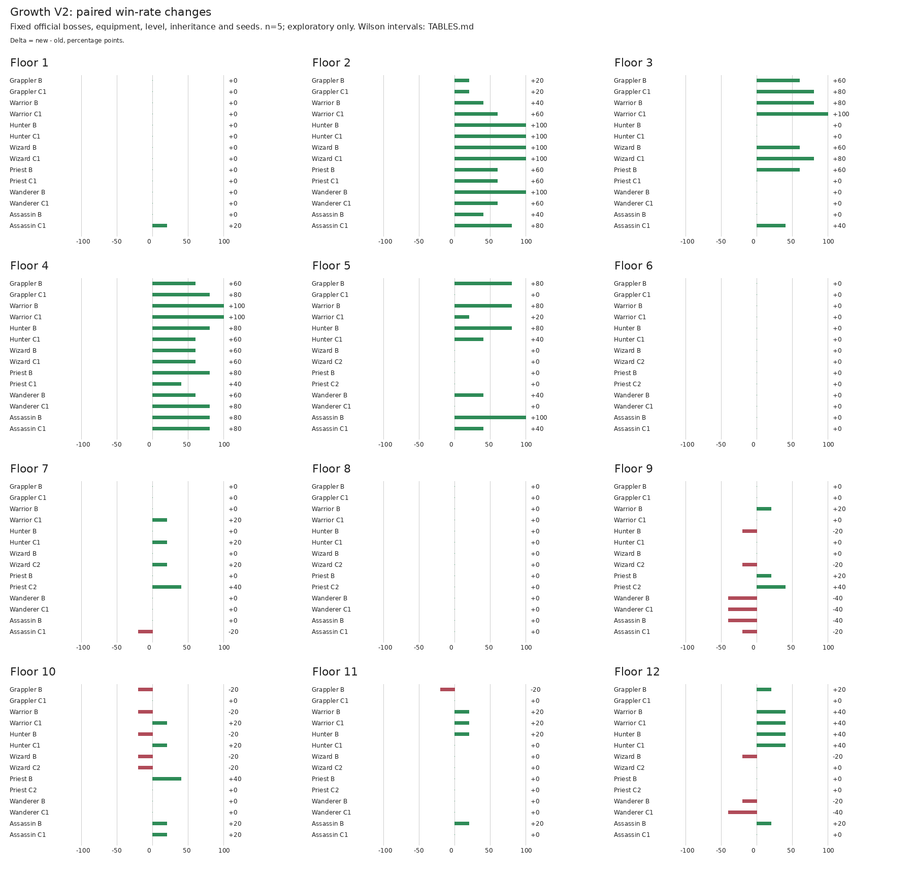

# Qhymia ボスバランス再検証 Stage 6-A

2026-11-20（JST）。成長Ver.2反映後の全12階層・全7職業・B/Cの新旧比較。

**336条件×5戦＝1,680戦をすべて測定した。新成長は2・4・5階を大きく易化させたが、7階の物理職Bの全敗は解消せず、9階には悪化した職業がある。8階は新旧ともB/C全勝で、勝率の天井に加えてボスの攻撃機会不足が残る。** 正式ボス・成長・戦闘・スキル・装備の変更は行っていない。

例外・未実行・引き分け・1,000ループ上限は0。実戦闘135.245秒、DB準備・条件準備・破棄込み153.381秒。各条件5seedの探索的比較であり、目標B約10%／C約50%への適合や、差の統計的有意性は確定しない。

## 成果物

|内容|保存先|
|---|---|
|全1,680戦の結果・全行動・HP変化・状態異常|[runs.jsonl](balance_stage6a/confirmed/measurement/runs.jsonl)|
|336条件の全プロフィール・実戦術・seed・ソース指紋|[manifest.json](balance_stage6a/confirmed/measurement/manifest.json)|
|旧版コミット・保存元・再生成方式・固定項目|[study_metadata.json](balance_stage6a/confirmed/measurement/study_metadata.json)|
|隔離DBから取得した12ボスの全フィールド・全35スキル|[official_catalog.json](balance_stage6a/confirmed/measurement/official_catalog.json)|
|正式ボス・技能の測定前後一致|[official_catalog_unchanged.json](balance_stage6a/confirmed/measurement/official_catalog_unchanged.json)|
|336条件の指標CSV|[conditions.csv](balance_stage6a/analysis_final/conditions.csv)|
|168組の旧新勝率・Wilson・差・対応反転|[comparison.csv](balance_stage6a/analysis_final/comparison.csv)|
|84組の素値・属性・戦闘開始値・表示戦闘力比較|[status_comparison.csv](balance_stage6a/analysis_final/status_comparison.csv)|
|階層別B/Cの記述合計・職業間最大差・全勝/全敗職|[floors.csv](balance_stage6a/analysis_final/floors.csv)|
|12階層×7職業×B/Cの全勝率表・Wilson95%|[TABLES.md](balance_stage6a/analysis_final/TABLES.md)|
|機械可読の全集計・集計元指紋|[results.json](balance_stage6a/analysis_final/results.json)|
|旧新勝率グラフ|[PNG](balance_stage6a/analysis_final/win_rate_comparison.png) / [SVG](balance_stage6a/analysis_final/win_rate_comparison.svg)|
|勝率差グラフ|[PNG](balance_stage6a/analysis_final/win_rate_delta.png) / [SVG](balance_stage6a/analysis_final/win_rate_delta.svg)|
|事前計画／実測反映後計画|[initial_plan.json](balance_stage6a/confirmed/initial_plan.json) / [execution_plan.json](balance_stage6a/confirmed/execution_plan.json)|
|最終パイロット48戦|[pilot_final](balance_stage6a/confirmed/pilot_final/)|
|全戦の対応・HP/ST台帳・過去成果物保持の検証|[validation_final.json](balance_stage6a/validation_final.json)|
|テスト実行結果／最終ソース指紋／旧関数AST照合|[test_results.json](balance_stage6a/test_results.json) / [final_source_sha256.json](balance_stage6a/final_source_sha256.json) / [legacy_source_audit.json](balance_stage6a/legacy_source_audit.json)|
|測定／集計／成果物検証スクリプト|[RUN](BALANCE_STAGE6A_RUN.py) / [REPORT](BALANCE_STAGE6A_REPORT.py) / [CHECK](BALANCE_STAGE6A_CHECK.py)|
|自動テスト|[test_balance_stage6a.py](../../apps/battle/test_balance_stage6a.py)|

`analysis/`は初回集計を保持したもの。上表の`analysis_final/`を最終版とする。最終版には、相手に与えた損傷と自傷を分離した列を追加した。生データ・勝率は同一で、戦闘の再実行はしていない。



## 基準版・安全性・実行経過

- 開始時main/HEADは`28a2d22b4d9e3bfd7221f221708d1e1980849ab9`。GitHubのmainと一致を確認した。通常DBやXAMPPの利用中DBは測定対象にしていない。
- 最初のfeatureブランチ作成は`.git`書き込み制限で反映されていなかった。追加ファイルと本測定開始時点はmain上で、`study_metadata.json`もその事実を保持する。承認済み操作で`feature/boss-balance-stage6a`を作成し、本測定途中から同ブランチ。開始・測定・最終のHEADは同じで、mainの追跡ファイルに変更はない。commit/push/mergeは行っていない。
- 既存`simulate_boss_v2`を再利用し、UUID付き`test_qhymia_simv2_...`の専用PostgreSQL DBを作成・migration・破棄した。通常DBにはmigrationもデータ更新も実施していない。
- 育成算出は全SQL禁止。戦闘中は既存`reject_writes`でSELECT以外を拒否する。プロフィール準備のCharacter/装備/永久技能/戦術保存は認可済み専用テストDB内だけ。正式Enemy/Skillへの保存処理を追加していない。
- 当初計画は336条件・1,680戦、戦闘347.209秒＋準備40秒＝387.209秒。上限600秒、パイロット上限180秒を設定した。
- 最終パイロットは7〜12階×重戦士/ウィザード×B/C×旧/新の48条件各1戦。seed`12061121`、戦闘約3.589秒、条件準備込み最終進捗9.0秒。例外・引き分け・上限0、正式値の前後一致を確認した。
- パイロットを反映した本測定予測は戦闘326.172秒＋準備40秒＝366.172秒。全336条件を均等に5seedのまま実行し、縮小なし。時間上限は既存ランナーによる戦闘間判定であり、単一戦闘やDB破棄を打ち切るハード制限ではない。
- 参照タイミングがない3/4/9/10階Cなどは、同階・同職業の旧予備B実測に余裕係数を掛けた。新成長未パイロット条件にも2倍等の余裕を持たせ、参照元と代用を計画JSONに明記した。
- 本測定seedは`11061120〜11061124`。開始前に旧16個の`runs.jsonl`を走査し、重複なしを確認した。パイロットは本測定に加算しない。
- 初回接続制限の失敗は`balance_stage6a/pilot/`、終了確認の認可ガード不備があった48戦は`confirmed/pilot/`、再接続制限の失敗は`confirmed/pilot_confirmed/`へ保持した。ガード不備は検証専用ラッパーで修正し、専用DBはfinallyで破棄した。最終パイロットは別seed・別出力の`pilot_final/`。途中の48戦を本測定や最終パイロットへ合算していない。

## 旧プロフィールの照合と新成長の再生成

保存元はStage 5-Aの`analysis/profiles.json`。154プロフィールから、0回帰の`none`と回帰済みの`trained`という既存の`recommendation_eligible`84件を採用した。新たなLv・種族・装備・回帰数の探索や、勝てる個体の選別はしていない。5-A/5-B/5-C Ver.2の保存manifestとも固定項目を照合した。

旧成長は、変更直前コミット`caf9664`の`apps/accounts/growth.py`と回帰関数を`git show`で読み取って実行した。Stage 1基準`f246afb`と同コミットの対象成長/回帰関数はASTで一致する。**全84件で、素8能力・6属性・補正済み戦闘開始値・ホーム表示戦闘力が保存値に完全一致した。** 保存値を単にコピーして旧式と名付けていない。

新成長は同じ育成seedから、現行`generate_reincarnation_bonus`、`calculate_reincarnation_stats`、`growth.level_up_once`を実行した。全件`legacy_reincarnation_points=0`。151回帰以降の初期配分減少と追加Lv抽選を適用し、各プロフィールの実抽選数を検証した。旧高回帰キャラの移行保護や、育成途中から新方式へ切り替える条件は混在していない。

|階|固定Lv|固定回帰|固定装備|新素HP−旧素HP|新表示戦闘力−旧表示戦闘力|
|---:|---:|---:|---|---:|---:|
|1|20|0|なし|+72〜+86|+105〜+116|
|2|70|0|なし|+192〜+348|+365〜+488|
|3|50|2|なし|+104〜+240|+243〜+343|
|4|80|5|なし|+198〜+336|+392〜+503|
|5|80|10|F+3×5|+235〜+366|+425〜+538|
|6|52〜98|20|旧職業別F+5〜+7混成|+146〜+324|+258〜+512|
|7|20〜86|94〜97|F+5×5|+41〜+346|+92〜+492|
|8|5〜99|198〜202|F+5×5|−478〜+1,142|−1,239〜+1,817|
|9|18〜65|271〜273|F+5×5|−588〜+1,869|−1,861〜+1,939|
|10|32〜73|406〜408|F+5×5|−250〜+1,750|−1,834〜+3,307|
|11|57〜87|494〜495|F+5×5|+928〜+6,303|+1,547〜+7,721|
|12|34〜90|654〜657|F+5×5|+342〜+11,041|−3,227〜+14,984|

全件ヒューマン、育成seed`20261116`、属性ウェイト全1、プレイヤーST100開始。最大STも元値を固定した。魔法職は魔法用、他職は物理用の旧装備を保持し、表示戦闘力を揃え直していない。高階層の数百回帰は旧評価用の到達例で、育成時間を測った正式推奨ではない。

最後の回帰の初期再配分と最終周の職業別Lv成長を直接再生する方式は旧評価と同じ。永久技能の職歴・取得コード・順序・追加取得なしの残回帰数も元データを固定した。回帰後の放浪人から最終周の評価職業へ転職する前提であり、各過去周を戦闘しながら育成した測定ではない。これらの費用・所要時間は未測定。

旧式の毎Lv3抽選/HP+5と、新式の毎Lv5抽選/HP+8では乱数消費位置も変わる。属性抽選仕様は同じ毎Lv3回だが、属性の実現値まで同じにはならない。同じ戦闘seedも、行動順や決着時点が変わると個々の命中・発動乱数の対応を保証しない。因果的に変更した入力は成長方式だけであり、HP単独など各能力の寄与を分離した実験ではない。

## 戦術と正式ボス

Bは既存Stage 5の攻撃・補助・回復を用いる標準戦術。通常攻撃限定ではない。各プロフィールに保存されたB/C1の順序・使用回数を保持した。魔法職は現在職業＋永久習得でC2の全3種を使える場合だけ、既存の`自由×1→アンチジェイル×12→ジャッジメント×8`を使用した。今回は1〜4階がC1、5〜12階のウィザード/プリーストがC2。それ以外はC1。スキル性能・発動率・MP・成功時の回数処理・パッシブ非消費は実装どおりで変更なし。

以下は専用DBの正式値。前回の未採用Ver.2案をロードしていない。技能の順序・各99回、1〜6階のスキルなしを維持した。全スキルのMP/発動率/種別/説明を含む実値はカタログJSONに保存した。未完成のフロストアーマー・浄化等を補完していない。

|階|正式ボス|HP|MP|STR|INT|DEX|AGI|VIT|LUK|ST|
|---:|---|---:|---:|---:|---:|---:|---:|---:|---:|---:|
|1|キングスライム|64|10|11|8|12|12|7|6|100|
|2|グレートウルフ|356|0|29|8|55|68|10|21|130|
|3|グランドゴーレム|1,060|0|90|15|30|17|115|13|160|
|4|ケイブドラゴン|2,000|150|135|85|82|65|110|65|180|
|5|イフリート|3,600|220|240|145|130|88|170|90|200|
|6|リヴァイアサン|9,600|2,400|350|900|420|145|480|260|240|
|7|アルラウネ|29,000|7,000|580|1,600|630|500|1,300|470|270|
|8|タイタン|50,000|4,600|950|470|600|180|3,100|380|310|
|9|イグニス|67,777|15,000|2,600|1,800|1,850|2,150|1,650|1,280|320|
|10|アビスデーモン|114,514|28,000|3,900|4,100|2,400|1,800|2,200|1,750|340|
|11|セレスティア|135,672|41,000|3,200|5,400|2,950|1,950|2,800|2,300|370|
|12|アポカリプス|156,924|56,000|5,600|5,600|4,150|3,400|4,500|3,450|400|

7階はステラ/毒矢/ヒーリングシールド/睡眠矢/フロストアーマー、8階は鋼の肉体/堅固な構え/反撃の構え/衝撃波/真拳、9階はフレアブレード/ファイア/連打/闘魂/狩人の眼、10階はメギド/一撃必殺/シャドウステップ/核心/ステルス、11階はジャッジメント/ステラ/ヒーリングシールド/浄化/アンチジェイル、12階はフレアブレード/メギド/鋼の肉体/ラピッドショット/自由の原則。正式内部コードはJSONを正とする。

## 全12階層の結果

各セルは7職業×5戦の記述合計「勝/35（率）」、最大差は同じ戦術の7職間の最大率−最小率。Cは各職業で適法なC1/C2を採用した評価区分である。職業合計を独立35試行の二項標本としてWilson区間や採用判定に使わない。

|階|旧B|新B|旧C|新C|B職業差 旧→新|C職業差 旧→新|
|---:|---|---|---|---|---|---|
|1|35/35 (100%)|35/35 (100%)|34/35 (97.1%)|35/35 (100%)|0→0pt|20→0pt|
|2|12/35 (34.3%)|35/35 (100%)|11/35 (31.4%)|35/35 (100%)|80→0pt|80→0pt|
|3|6/35 (17.1%)|19/35 (54.3%)|7/35 (20.0%)|22/35 (62.9%)|40→100pt|100→100pt|
|4|3/35 (8.6%)|29/35 (82.9%)|8/35 (22.9%)|33/35 (94.3%)|40→40pt|60→40pt|
|5|16/35 (45.7%)|35/35 (100%)|30/35 (85.7%)|35/35 (100%)|100→0pt|40→0pt|
|6|35/35 (100%)|35/35 (100%)|35/35 (100%)|35/35 (100%)|0→0pt|0→0pt|
|7|6/35 (17.1%)|6/35 (17.1%)|20/35 (57.1%)|24/35 (68.6%)|60→60pt|80→60pt|
|8|35/35 (100%)|35/35 (100%)|35/35 (100%)|35/35 (100%)|0→0pt|0→0pt|
|9|25/35 (71.4%)|22/35 (62.9%)|21/35 (60.0%)|19/35 (54.3%)|40→60pt|40→40pt|
|10|20/35 (57.1%)|19/35 (54.3%)|24/35 (68.6%)|26/35 (74.3%)|40→80pt|40→40pt|
|11|32/35 (91.4%)|34/35 (97.1%)|34/35 (97.1%)|35/35 (100%)|20→20pt|20→0pt|
|12|24/35 (68.6%)|28/35 (80.0%)|27/35 (77.1%)|29/35 (82.9%)|40→40pt|40→40pt|

同一seedの旧負→新勝191件、旧勝→新負31件。勝数が同じ条件にも相互の反転があり、勝率差0は同じ戦闘結果を意味しない。全168組の反転seed/勝者を比較CSVに収録した。

各5戦のWilson95%は、0勝0〜43.4%、1勝3.6〜62.4%、2勝11.8〜76.9%、3勝23.1〜88.2%、4勝37.6〜96.4%、5勝56.6〜100%。点推定は20pt刻みなのでBの5〜15%帯への適合は点推定だけでも認定できない。多重比較補正なし。育成seedは1つ、戦闘seedは全条件で共有した5つに限られる。旧資料の異なるseedによる勝率と今回の旧成長実測は合算せず、過去の点推定との差を成長効果とも解釈しない。

## 1階：生存余裕が増え、全職業が勝率の天井へ到達

旧B35/35・C34/35、新B/C各35/35。職業差はB0→0pt、C20→0pt。暗殺者Cの4→5勝以外は勝数不変で、新は全7職業B/C各5勝。

初期戦闘HPの14条件平均は72→148.9、ボス行動3.21→1.01、被ダメージ17.6→4.7、決着5.87→3.79ループ。MP不足ログも70戦合計95→27回で、通常攻撃への代替が平均1.64→0.63行動へ減った。HP増加だけでなく攻撃側の成長と短期決着にも整合する。

初心者の職業差はこの標本では縮小したが、難易度目標からの距離は大きい。全勝を初心者適正の確定根拠にしない。再調整は必要候補。次は正式値からHPまたはAGIの単独感度を確認し、全職業に行動機会を残す方向を検討する。序盤の体験目標を独断で例外仕様へ変更しない。

## 2階：以前の低勝率職も全勝となる大きな易化

旧B12/35・C11/35、新B/C各35/35。B/C職業差はともに80→0pt。旧では狩人・ウィザードがB/C全敗、放浪人Bも全敗だった。新は全職業各5勝で、格差の縮小と勝率の天井が同時に起きた。

初期戦闘HP平均167.6→405.1、被ダメージ153.3→51.6、ボス行動9.13→5.39、決着11.66→7.41ループ。AGI68の高速ボスという条件は同じでも、HP/攻撃/速度を含む成長結果の差で生存と決着が変わった。回復到達件数は5/70のままで、回復回数だけを改善要因にしない。

最優先群の再調整候補。旧低勝率職を再び全敗に戻す一律火力強化は避け、HPとAGIを別々に調べる。特に以前の全敗3職を残して比較する。今回の全勝だけから新しい正式値を決めない。

## 3階：平均は改善しても、全勝職と全敗職が分かれる

旧B6/35・C7/35、新B19/35・C22/35。B職業差40→100pt、C100→100pt。新Bは拳闘士/ウィザード/プリースト各5勝、狩人/放浪人/暗殺者各0勝。新Cは拳闘士/重戦士/魔法2職各5勝、狩人/放浪人各0勝、暗殺者2勝。

新はプレイヤー行動10.09→13.66、決着13.93→19.51ループ。長期化は単純な悪化ではなく、以前より生存して攻撃する事例が増えたことと整合する。狩人Cは平均行動9.2→15.2、相手への損傷428.4→903.4へ増えても0/5。放浪人Cは新でもMP不足34回/5戦、通常攻撃平均9回、相手の残HP平均345.8で敗北した。

VIT115に対する物理側の効率、低回帰の部分継承、MP/有限技能による制約を分けて確認すべき階。全B/C合算で魔法は10/20→20/20、物理は3/50→21/50で、格差は解消していない。再調整の優先度は高いが、HP一律変更よりVITの単独感度と低勝率職の行動台帳を先に確認する。戦術は今回のまま固定する。

## 4階：旧Bの記述合計8.6%から82.9%へ変化

旧B3/35・C8/35、新B29/35・C33/35。B職業差40→40pt、C60→40pt。新は全敗職なし。Cはウィザード3/5以外の6職が全勝、Bは拳闘士/重戦士/プリーストが全勝。

初期戦闘HP平均469→704.9、プレイヤー行動8.64→9.84、被ダメージ472.5→412.5。旧は短期敗北が多く、新は決着が11.61→12.97ループへ延びて攻撃機会が増えた。全戦でMP不足0なので、主要差をMP枯渇解消とは説明しない。

旧Bの合算が目標に近かったことを新成長に持ち越せない。再調整が必要候補で、HPやSTRを単独比較する。ただし新ウィザードがB/C各3勝に留まるため、物理職と同じ余裕がある前提で一括強化しない。

## 5階：HP増加と短期決着で物理側も全勝

旧B16/35・C30/35、新B/C各35/35。B職業差100→0pt、C40→0pt。旧の魔法2職はB/C合計20/20、物理5職26/50だったが、新は魔法20/20・物理50/50。F+3と10種継承は維持した。

初期戦闘HP平均722.9→994.6、ボス行動5.21→4.10、被ダメージ662.4→487.4。素STRも+19〜+30となり、攻撃側の成長・防御側の成長・HP増を含む総合差として生存が改善した。Bの回復到達は34/35→35/35で、回復量も70戦平均111.1→120.4。

全勝により職業間の潜在差を観測しにくい。再調整は必要候補。旧未採用案HP4,600/STR300を正式値として再利用せず、今回の正式HP3,600/STR240からHP/STRを別々に比較する。全勝から直ちに大幅強化を採用しない。

## 6階：勝率は変わらず、被害がさらに減る

旧新ともB/C各35/35、職業差0pt。全7職業で勝率の天井が維持された。Lv52〜98と職業別の旧装備を固定し、新戦闘力を5,000に合わせ直していない。

初期戦闘HP平均1,161.9→1,397.9、被ダメージ372.0→302.0、ボス行動3.54→3.09、決着12.39→11.94ループ。新の余裕が増している。正式ボスはスキルなしでMP2,400。独自の水魔法は与えず、MPの多さを実行火力とみなさない。

再調整候補だが、Stage6-Aで新たに勝敗が動いた階より優先度は下げる。HPまたは通常攻撃に関わるSTR/AGIの単独比較を検討する。新スキルの追加や、未採用案STR999の採用は今回の結果からは判断できない。

## 7階：INTと回復到達の問題が成長強化後も残る

旧B6/35・C20/35、新B6/35・C24/35。B職業差60→60pt、C80→60pt。新Bは拳闘士/重戦士/狩人/暗殺者が全敗、魔法はウィザード3/5・プリースト2/5。新Cは放浪人/ウィザード5/5、重戦士/暗殺者2/5、他3/5・3/5・4/5と幅がある。

新の素INT差は−1〜+34。ボスINT1,600は魔法攻撃と魔法防御の双方に関わる。プレイヤー被害のうちステラ実HP損傷は旧238,501/324,841（73.4%）、新251,238/337,928（74.3%）。毒と睡眠も残り、毒中の行動は84→81、睡眠中の行動は27→34回/70戦だった。これらは「状態が有効だった行動」で、すべて行動不能になった回数ではない。

物理Bで回復に届いた新戦闘は拳3/5・重4/5・狩4/5・暗5/5。それでも全敗で、回復前に倒れる問題だけではない。重戦士Bの行動は7→8、相手への損傷11,106→12,305でも足りず、Cは23,942→26,535で1→2勝。魔法C2はウィザード4→5勝、プリースト2→4勝へ改善した。

平均B17.1%/C68.6%だけで良好と判定しない。職業格差への対応を最優先群に置く。INT低下は敵火力と魔法職の貫通効率を同時に変え、既に高い魔法Cをさらに易化し得る。HPやINTの単独感度を、物理B全敗と魔法C高勝率の両方を残して確認する。INT一律低減の正式採用は保留。

## 8階：高勝率の天井と、ほぼ行動できないタイタン

旧新ともB/C各35/35、職業差0pt。新は旧より勝率を上げる余地がなく、「悪化なし」ではなく天井に隠れている。プリーストは202回帰Lv5のため素HP9,230→8,752・戦闘力26,381→25,142へ低下しても全勝した。

ボスAGI180に対し評価キャラのAGIは大幅に高く、ボス平均行動0.51→0.43。全70戦のボスによるスキル損傷は旧新とも0、通常攻撃の被害平均15.7→2.7。新の70戦平均初期HPは9,866.4であり、勝率よりもこの行動機会差が強い懸念となる。

狩人Cの毒損傷平均1,000→635.6、暗殺者Cは2,465→231.2へ減っても全勝した。今回の高勝率を毒だけで説明できない。Cでは有限技能の全枠枯渇はなく、狩人/暗殺者の新行動も平均8.4/9.0回で決着した。Bでは一部枠（例：回復2回）が0になるが、全アクティブ枠の枯渇とは別。

調整確認の最優先。前回のHP増加だけの比較には毒の最大HP連動と職業差の問題があった。次は正式値のAGIを入口に攻撃機会が生じるかを先に確認し、HP単独案をその後に比較する。旧AGI900の高勝率という過去証拠も残し、新成長では未測定と区別する。正式値の変更は未実施。

## 9階：低Lv高回帰の能力低下が一部の勝率低下と対応

旧B25/35・C21/35、新B22/35・C19/35。B職業差40→60pt、C40→40pt。新Bは重戦士5/5、狩人/暗殺者2/5。新Cは狩人/プリースト4/5、拳闘士/重戦士/ウィザード/放浪人2/5。

狩人は273回帰Lv19で素HP12,425→11,837、STR2,462→2,325、AGI2,395→2,245。Bは3→2勝。放浪人は273回帰Lv18、戦闘力35,380→33,584、B5→3勝・C4→2勝。暗殺者もB4→2勝・C4→3勝。一方、271回帰Lv65のプリーストはHP12,365→13,079でB3→4勝・C2→4勝となった。

70戦平均の初期HPはほぼ横ばいでも、被ダメージ9,939.7→10,519.8、回復量1,622.4→1,430.7。職業ごとの固定Lv差と高回帰配分が合算で隠れる。MP不足は旧新0で、MP枯渇を原因にしない。

Cの合算54.3%は目標に近いが適合認定しない。現時点で一律ボス強化を先行する根拠は弱く、まず低Lv高回帰プロフィールの位置づけと職業差を確認する。今回固定条件を変えて補正することはしない。再調整は条件整理後の候補。

## 10階：相討ち勝利を分けて読む必要がある

旧B20/35・C24/35、新B19/35・C26/35。B職業差40→80pt、C40→40pt。新Bはウィザード1/5から暗殺者5/5まで分かれ、新Cは狩人/暗殺者が5/5。新のウィザードは408回帰Lv32で戦闘力52,382→50,548、B2→1勝・C4→3勝。

**旧成長Bの9戦で両者HP0のプレイヤー勝利が発生した。** 内訳は拳闘士1・重戦士3・狩人2・暗殺者3。例は`s6a-f10-grappler-old-B-u1`、seed`11061120`：真拳がボス残HP11,638を削り、同時に反射がプレイヤー残HP4,307を削った。現在の敵全滅優先判定で勝利になる。新側は0件。報告勝数は正式なエンジン結果を維持し、独自に負けへ再分類していない。

旧Bの生存勝利は11/35、新Bは19/35であり、勝率20→19だけから生存悪化とは読めない。これは新指標による補助説明で、正式勝率を置き換えるものではない。反射を含む全HP台帳は一致した。

勝敗仕様の確認事項を、能力値調整と独立して残す。新成長でB/Cの職業差もあるため再調整候補だが、まず相討ちを許す仕様の扱いを確認する。今回の作業では判定もボスも変更しない。

## 11階：魔法C2は全勝を維持し、物理側も天井へ近づく

旧B32/35・C34/35、新B34/35・C35/35。B職業差20→20pt、C20→0pt。魔法2職C2は旧新とも各5/5。物理5職はB/C合計46/50→49/50となり、新Bの拳闘士4/5を除く全条件が全勝した。

素HPは全職で+928〜+6,303、表示戦闘力は+1,547〜+7,721。初期戦闘HP平均22,622→26,422、被ダメージ15,148→13,462、ボス行動4.60→4.06、決着13.99→13.13ループ。ジャッジメント等の麻痺有効行動は88→80回/70戦。MP不足は0で、魔法C2の高勝率は維持された。

魔法/物理の勝率差はこの5seedでは縮小したが、全勝による観測の天井であり、同等の性能が確定したわけではない。再調整優先度は高い。HPやAGIを単独比較し、魔法職の効率と拳闘士の低下を両方追う。前回未採用案のLUK7,777等を正式値と混同しない。

## 12階：全体ではCが上だが、職業別にはB>Cの逆転がある

旧B24/35・C27/35、新B28/35・C29/35。B/C職業差はともに40ptを維持。新Cは重戦士/狩人/暗殺者5/5、魔法2職4/5、拳闘士/放浪人3/5。

**新の拳闘士と放浪人はB4/5>C3/5。** それぞれ同seedでBだけ勝つ戦闘が2件、Cだけ勝つ戦闘が1件あり、B/Cの逆転を階層合算で隠せない。放浪人は657回帰Lv34で戦闘力83,382→80,155、STR5,836→5,551、INT5,933→5,306、AGI5,913→5,626。Bは旧5→新4勝、Cは5→3勝へ悪化した。

新放浪人Bは平均回復6,906.8、行動9.0回、相手への損傷153,152.6、Cは回復0・行動6.4回・損傷140,753.2。回復を挟む生存延長が攻撃機会を生む事例と整合する。一方、ウィザードはB平均回復8,062.6でも3/5、C2は回復0・4/5。回復が全職で常に有利という結論にもならない。

全70戦平均は初期HP29,648.7→32,771、回復3,283.2→3,515.7。MP不足は旧新0。重戦士・狩人の改善と低Lv放浪人の悪化が混在するため、一律弱体化/強化を即決しない。回復の有無と攻撃回数を固定戦術のまま追い、HP/STR/INTを一つずつ比較する候補。Cを必ずBより強く見せる戦術変更は行っていない。

## 調整確認の優先順位

次はユーザーが本結果を確認した後に行う候補で、未測定・未採用。新しい値を正式反映する根拠にはしない。

|順|階|優先する問題|次に分離して確認する候補|
|---:|---:|---|---|
|1|8|全勝・ボス平均行動0.43・技能損傷0|AGIと行動機会を先行、HPだけの強化は後段|
|2|7|物理B4職全敗と魔法C高勝率|HP/INT単独。INTの攻防同時作用を記録|
|3|3|全勝職と全敗職、職業差100pt|VIT、物理効率、低回帰の有限技能/MP|
|4|2|旧低勝率職を含め全条件全勝|HP/AGI単独、旧低勝率職の生存境界|
|5|5|F+3固定で新全条件全勝|正式HP/STRの単独感度|
|6|11|魔法C2全勝維持・物理も全勝化|HP/AGI単独、両系統の効率差|
|7|4|旧B8.6%から新82.9%への変化|HP/STR単独、ウィザードへの影響|
|8|12|拳闘士/放浪人のB>C、高回帰低Lvの低下|回復・攻撃機会、HP/STR/INT単独|
|9|6|旧新とも全勝、生存余裕増加|通常攻撃型のHP/STR/AGI単独|
|10|9|一部低Lv高回帰の悪化とB高勝率|まず評価経路と職業差、数値変更は保留|
|11|10|相討ち勝利と新Bの職業差|勝敗仕様の確認を別扱い、数値はその後|
|12|1|元からほぼ全勝、新は全勝・短期化|初心者条件のHP/AGI感度。目標の例外化はしない|

10階の相討ち仕様確認は、このバランス測定順とは別の確認事項として残す。全階層を一括倍率で変更することは勧めない。低Lv高回帰・育成時間・別育成seed・移行保護あり・別種族・属性特化・追加戦闘seedは未検証。

## 検証・変更一覧・復元

追加は検証用RUN/REPORT/CHECK、9件の自動テスト、当報告、`balance_stage6a/`の成果物。AGENTSへ最新到達点を追記する。アプリの本体処理や設定、migrationの追加/変更はない。`QHYMIA_CONTEXT.md`は保持し、追記候補は「2026-11-20、成長Ver.2新規育成・legacy=0の全12階比較完了、正式値は未変更。詳細は本資料」とする。

|確認|結果|
|---|---|
|Stage6-A専用テスト|初回9件成功3.346秒、最終9件成功3.297秒|
|最終全体テスト|561件成功、76.130秒、終了コード0、skip/期待失敗なし|
|全戦のcase/seed・対応条件・正式ボス・HP/ST台帳|1,680件一致、欠測0|
|旧プロフィール実コード再生|84件、全素値/属性/戦闘開始値/戦闘力一致|
|測定時ソース指紋と終了時ソース|一致|
|既存594ファイル|593件の指紋一致、AGENTSへの追記のみ変更、削除0|
|Djangoシステムチェック／差分・追加ソース空白確認|問題なし|

観測あり/なしで高回帰の旧新・8/12階の結果digest一致、SQL禁止、正式ボス以外の値の拒否、資格によるC2選択、時間縮小時も全条件均等3seed、欠測/例外を0勝扱いしない集計を自動テストで確認した。

`conditions.csv`の`damage_dealt`は既存観測器の分類を保持し、自傷カテゴリを含み得る。最終版の`*_damage_to_opponent`を相手への実損傷、`*_self_damage`を自傷として参照する。`*_damage_taken_total`には相手の攻撃・毒・反射・自傷等の実HP減少が入る。回復量は上限を超える予定量ではなく実回復量。`exhausted_slots`は一部枠の残回数0であり、全技能が尽きた意味ではない。状態有効行動・遷移・MP不足・残回数と最終HP/MP/STは各戦のJSONLを正とする。

再実行時は未使用の出力先を指定する。通常DBの`migrate`や測定コマンドの通常DB実行を行わない。

```bash
venv/bin/python docs/変更詳細/BALANCE_STAGE6A_RUN.py --plan --output /tmp/qhymia-stage6a-rerun
venv/bin/python docs/変更詳細/BALANCE_STAGE6A_RUN.py --pilot --output /tmp/qhymia-stage6a-rerun --pilot-name pilot_final
venv/bin/python docs/変更詳細/BALANCE_STAGE6A_RUN.py --run --output /tmp/qhymia-stage6a-rerun --pilot-name pilot_final
venv/bin/python docs/変更詳細/BALANCE_STAGE6A_REPORT.py --source /tmp/qhymia-stage6a-rerun/measurement --output /tmp/qhymia-stage6a-rerun/analysis
venv/bin/python manage.py test apps.battle.test_balance_stage6a --noinput
```

今回の成果物だけを作業木から外す場合は、追加ファイルとディレクトリを個別に退避し、AGENTSの本Stage6-A追記だけを元へ戻す。開始時から存在した未追跡ファイル、旧測定ディレクトリ、通常DBを巻き込まない。復元のための削除・上書き操作も今回は実施していない。ボスの正式採用、追加調整測定、commit/push/mainマージへは進まず、ここで測定作業を停止する。
