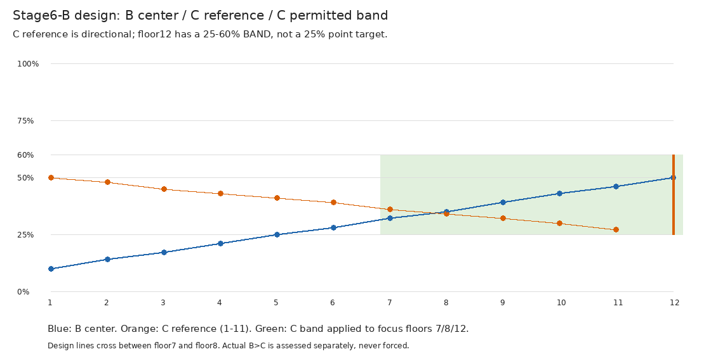
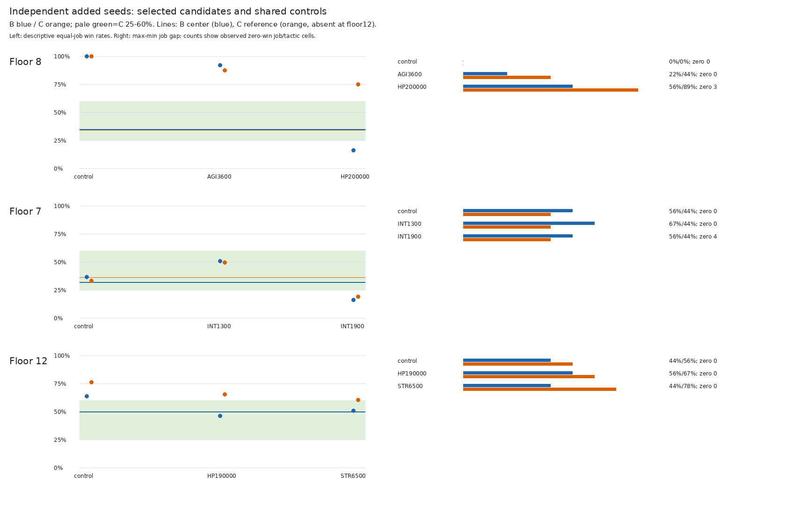

# Qhymia ボスバランス調整 Stage 6-B（改訂目標）

2026-11-20（JST）。対象は8階タイタン、7階アルラウネ、12階アポカリプス。正式値は変更せず、Stage 6-Aの新成長プロフィールで単一能力候補を比較した。

**パイロット40戦、候補比較1,610戦、独立した追加確認1,134戦、合計2,784戦を完了した。全戦で例外・欠測・引き分け・ループ上限0。8階には採用を勧められる単独候補がなく、7階は今回の追加seedでは現行値がB中心目標に最も近い。12階STR6,500はB50.8%・C60.3%で有力な比較候補だが、Cの上限超過と職業差を残すため正式採用を保留する。**

全569テスト成功。ゲーム本体・通常DB・Stage 6-A・既存未追跡ファイル・バックアップを保持した。作業ブランチは`feature/boss-balance-stage6b`、HEAD`28a2d22`。commit/push/mainマージ・正式ボス変更・新migrationは行っていない。

## 新しい評価目標

今回のユーザー指示が旧B10%/C50%の一律目標に優先する。Bは各階層の中心との距離で評価し、許容幅を独自に設定しない。C参考ラインは方向性であり、厳密な一致を合格条件にしない。

|階|B中心|C参考ライン|
|---:|---:|---|
|1|10%|50%|
|2|14%|48%|
|3|17%|45%|
|4|21%|43%|
|5|25%|41%|
|6|28%|39%|
|7|32%|36%|
|8|35%|34%|
|9|39%|32%|
|10|43%|30%|
|11|46%|27%|
|12|50%|25〜60%の許容範囲。25%を中心目標にしない|

重点3階層の高階層Cは25〜60%の帯で評価した。帯内ではすべて「帯外距離0」で、C45%をC25%より低評価にする項目はない。たとえばB50%・C45%とB50%・C25%は、勝率条件の評価が等しい。その先は職業差・戦闘時間・回復・行動機会で判断する。

設計上のB/C参考線は7〜8階付近で交差する。実測のB>Cは絶対条件にせず、中心距離・C許容帯・交差傾向・職業差の4項目を分けた。



## 実行条件と保存先

Stage 6-Aの[新成長manifest](balance_stage6a/confirmed/measurement/manifest.json)から、重点3階×7職業の21プロフィールを取得した。現行成長コードで再生成して素値/属性/戦闘開始値/表示戦闘力の一致も確認した。種族・Lv・回帰・装備・強化・永久技能・取得履歴・戦術・使用回数・育成seed・ST・属性ウェイトを固定し、`legacy_reincarnation_points=0`を維持した。Bは攻撃・補助・回復を使う既存戦術。魔法職のCは6-Aと同じ適法なC2、他はC1で、戦術の変更なし。

既存`simulate_boss_v2`と`BattleEngine`を再利用した。候補は認可済み専用PostgreSQLテストDBで取得したEnemyのメモリ上コピーにだけ設定し、1候補1フィールドに限定した。全12ボス・35スキルを6-Aの正式カタログと照合し、各段階の前後一致を確認した。通常DB/XAMPP利用中DBへの書き込みやmigrationはない。育成算出は全SQL禁止、戦闘中はSELECT以外禁止。テストDBだけを作成・準備・破棄した。

|内容|保存先|
|---|---|
|事前計画・全候補・全目標・seed確認|[initial_plan.json](balance_stage6b/initial_plan.json)|
|パイロット40戦|[pilot/runs.jsonl](balance_stage6b/pilot/runs.jsonl)|
|候補比較1,610戦|[screen/runs.jsonl](balance_stage6b/screen/runs.jsonl)|
|独立追加確認1,134戦|[confirm/runs.jsonl](balance_stage6b/confirm/runs.jsonl)|
|プロフィール・実戦術・試行数・ソース指紋|[screen manifest](balance_stage6b/screen/manifest.json) / [confirm manifest](balance_stage6b/confirm/manifest.json)|
|正式12ボス全フィールド・35スキル|[official_catalog.json](balance_stage6b/confirm/official_catalog.json)|
|正式値の保持確認|[pilot](balance_stage6b/pilot/official_catalog_unchanged.json) / [screen](balance_stage6b/screen/official_catalog_unchanged.json) / [confirm](balance_stage6b/confirm/official_catalog_unchanged.json)|
|各職業・戦術の全指標CSV|[screen_conditions.csv](balance_stage6b/analysis/screen_conditions.csv) / [confirm_conditions.csv](balance_stage6b/analysis/confirm_conditions.csv)|
|ボス候補の比較CSV・比較表|[screen_candidates.csv](balance_stage6b/analysis/screen_candidates.csv) / [confirm_candidates.csv](balance_stage6b/analysis/confirm_candidates.csv) / [CANDIDATES.md](balance_stage6b/analysis/CANDIDATES.md)|
|同seed対照比・勝敗反転・Wilson|[screen_comparison.csv](balance_stage6b/analysis/screen_comparison.csv) / [confirm_comparison.csv](balance_stage6b/analysis/confirm_comparison.csv)|
|全職業の勝率・Wilson95%・欠測表示|[TABLES.md](balance_stage6b/analysis/TABLES.md)|
|全集計・入力指紋|[results.json](balance_stage6b/analysis/results.json)|
|目標設計・全候補・確認結果・職業別のグラフ|[目標PNG](balance_stage6b/analysis/target_design.png) / [SVG](balance_stage6b/analysis/target_design.svg)、[全候補PNG](balance_stage6b/analysis/screen_candidates.png) / [SVG](balance_stage6b/analysis/screen_candidates.svg)、[確認PNG](balance_stage6b/analysis/confirm_candidates.png) / [SVG](balance_stage6b/analysis/confirm_candidates.svg)、[職業別PNG](balance_stage6b/analysis/confirm_jobs.png) / [SVG](balance_stage6b/analysis/confirm_jobs.svg)|
|自動選択と、8階の確認候補レビュー|[selection.json](balance_stage6b/selection.json) / [selection_reviewed.json](balance_stage6b/selection_reviewed.json)|
|実測反映後の計画・縮小内容|[screen_plan.json](balance_stage6b/screen_plan.json) / [confirm_plan_final.json](balance_stage6b/confirm_plan_final.json)|
|開始時671ファイルの指紋・最終検証|[before.json](balance_stage6b/before.json) / [validation_final.json](balance_stage6b/validation_final.json)|
|自動テスト・結果|[test_balance_stage6b.py](../../apps/battle/test_balance_stage6b.py) / [test_results.json](balance_stage6b/test_results.json)|
|実行・追加確認・集計・成果物検証|[RUN](BALANCE_STAGE6B_RUN.py) / [CONFIRM](BALANCE_STAGE6B_CONFIRM.py) / [REPORT](BALANCE_STAGE6B_REPORT.py) / [CHECK](BALANCE_STAGE6B_CHECK.py)|

各戦JSONLには、実ボス全値、プレイヤー初期値、全行動、HP変化、状態遷移、通常攻撃/技能回数、実損傷/実回復、MP不足、残技能回数、最終HP/MP/ST、終了状態を保存した。相手への損傷と自傷を分離し、単一枠の枯渇と全アクティブ枠枯渇も区別した。

## 候補と測定規模

正式値の対照群は、8階HP50,000/AGI180、7階HP29,000/INT1,600、12階HP156,924/STR5,600/INT5,600。候補で指定した1フィールド以外の全値・属性・ST・スキル・各99回を保持した。過去の未採用ボスVer.2案を正式値として使用していない。

|階|先に調べた能力|候補値|別に調べた能力|候補値|
|---:|---|---|---|---|
|8|AGI|900 / 1,800 / 2,700 / 3,600|HP|100,000 / 150,000 / 200,000|
|7|HP|20,000 / 24,000 / 36,000|INT|1,000 / 1,300 / 1,900|
|12|HP|190,000 / 220,000 / 260,000|STR / INT|それぞれ6,500 / 7,500|

対照3群＋候補20群＝23群。8階はAGI系列を先に、その後HP系列を測定した。HPとAGI等の同時変更はしていない。

|段階|条件・試行|seed|予測時間（準備込み）|実戦闘|実経過（破棄込み）|
|---|---|---|---:|---:|---:|
|pilot|40条件×1戦＝40戦|21061120|51.682秒|7.486秒|13.324秒|
|screen|322条件×5戦＝1,610戦|22061120〜22061124|当初514.325秒、pilot反映後530.772秒|266.015秒|287.335秒|
|confirm|126条件×9戦＝1,134戦|23061120〜23061128|567.846秒|242.427秒|255.197秒|

事前に旧19個の結果JSONLを走査してseed重複なしを確認した。段階間もseedを分離した。上限はpilot180秒、screen/confirm各600秒。追加確認は当初15seedを予定したが、保守的な「実測最大時間×2」の予測では10seedでも626.496秒となったため、全条件を均等に9seedへ縮小した。超過を検出した[最初の確認計画](balance_stage6b/confirm_plan.json)も保持した。この段階ではDB作成・戦闘を開始しておらず、試行の隠れた欠落はない。

時間上限は既存ランナーの戦闘間判定で、単一戦闘やDB破棄のハード打ち切りではない。今回は未到達。単一戦闘は既存1,000ループ上限を維持した。

## 選別と統計上の扱い

事前の機械選別は、各階で「B中心距離＋C帯外距離」が最小の候補を1つ、そこから20pt以内を優先して全敗職数・最大職業差を重視する候補を1つ選ぶ方式とした。C帯内は距離0。交差傾向とC参考線からの距離は順位へ入れていない。この点数は確認対象を絞る道具であり、採用判定を自動化するものではない。

8階では20pt以内に2番目の候補がなく、機械規則のフォールバックは格差0だが全勝のAGI1,800を選んだ。ユーザー指定の行動機会を確認するため、追加確認前のレビューでこれをAGI3,600へ変更した。screenでボス平均行動は1,800が12.44回、3,600が25.04回、後者は勝敗の変化も出ていた。機械選択・変更理由・元結果を残し、選別が事後的であることを隠していない。他の5候補は機械選択どおり。

**主評価はconfirmの新9seed。** 選んだ6候補＋3対照を全7職業B/Cで測った。screen5seedとの計14seed合算は探索的補助集計として別CSVへ保存し、主結果に置き換えない。合算も、両段階で共通する9群だけに限定し、全員同じ14seedで比較した。未確認の候補5seedを14seed対照と比較することはない。pilotは統計に加えない。

各職業・戦術のWilson95%は表/CSVに保存した。9戦でも0/9の区間は0〜29.9%、9/9は70.1〜100%。全敗・全勝は観測結果であり真の確率0/100%の断定ではない。7職業合計の63戦は異なる固定キャラの記述合計で、共通seedの相関もあるため独立二項標本としてWilson区間を付けない。多数条件の比較に多重比較補正はしていない。

今回の対照も6-Aと同じプロフィール・エンジンだが、新しいseedで再測定した。たとえば7階の新B/Cは6-Aの17.1%/68.6%に対してscreen37.1%/51.4%、confirm36.5%/33.3%だった。これは調整効果ではない。候補の効果は各段階内の同seed対照との対応比較で読む。

## 独立追加確認：4つの観点を分けた比較

|階|候補|B 勝/63・率|B中心との差|C 勝/63・率|C許容帯との関係|B−C|B/C職業最大差|
|---:|---|---|---:|---|---|---:|---|
|8|現行|63/63・100%|+65.0pt|63/63・100%|上限+40.0pt|0.0pt|0.0/0.0pt|
|8|AGI3,600|58/63・92.1%|+57.1pt|55/63・87.3%|上限+27.3pt|+4.8pt|22.2/44.4pt|
|8|HP200,000|10/63・15.9%|−19.1pt|47/63・74.6%|上限+14.6pt|−58.7pt|55.6/88.9pt|
|7|現行|23/63・36.5%|+4.5pt|21/63・33.3%|帯内（記述）|+3.2pt|55.6/44.4pt|
|7|INT1,300|32/63・50.8%|+18.8pt|31/63・49.2%|帯内（記述）|+1.6pt|66.7/44.4pt|
|7|INT1,900|10/63・15.9%|−16.1pt|12/63・19.0%|下限−6.0pt|−3.2pt|55.6/44.4pt|
|12|現行|40/63・63.5%|+13.5pt|48/63・76.2%|上限+16.2pt|−12.7pt|44.4/55.6pt|
|12|HP190,000|29/63・46.0%|−4.0pt|41/63・65.1%|上限+5.1pt|−19.0pt|55.6/66.7pt|
|12|STR6,500|32/63・50.8%|+0.8pt|38/63・60.3%|上限+0.3pt|−9.5pt|44.4/77.8pt|

「帯内」は点推定の記述で、母勝率の適合が確定した意味ではない。12階STR6,500のCは38/63＝60.317…%であり、整数に丸めて60%として合格扱いしない。一方、0.3pt差だけで能力案を断定的に棄却する精度もない。職業差と不確実性を含めて保留する。



## 8階タイタン：行動機会は改善するが、単独調整では目標と格差を両立しない

### AGI単独

screenではAGI900/1,800がB/Cとも35/35、2,700がB35/35・C32/35、3,600がB30/35・C28/35。AGI3,600のconfirmはB58/63・C55/63で、5seed時よりも高勝率だった。現行対照はB/C各63/63。対照勝→候補負はB5件・C8件、逆向き0件。

現行の平均ボス行動はB0.71/C0.17。AGI3,600ではB25.65/C19.73まで増え、初期の行動不足は改善した。Bの被害平均は約7→6,432、実回復は約5→2,330となった。ただし勝率はB中心35%にもC上限60%にも近づき切れていない。

AGI3,600の126戦では、ボス技能の成功回数は鋼の体464・盤石の構え439・反撃の構え429・衝撃波394・真拳一殺363。行動数には補助行動も含む。行動数が増えたことと十分な攻撃圧があることを同一視しない。B>Cの交差は自然に出たが、勝率条件を満たす根拠にはならない。

### HP単独

screenはHP100,000がB/C各35/35、150,000がB21/35・C35/35、200,000がB8/35・C26/35。HP150,000でもプリーストB0/5、200,000では重戦士/プリーストB0/5を記録した。

HP200,000のconfirmはB10/63・C47/63。Bは重戦士/プリースト/暗殺者が各0/9。Cは狩人/ウィザード/放浪人/暗殺者が各9/9、プリースト1/9・重戦士3/9。Cの最大差88.9ptで、平均だけでは評価できない。

Bの平均193.35ループ・プレイヤー96.62行動、Cは114.30ループ・60.44行動まで長期化し、**B/Cとも63/63戦で全アクティブ技能を使い切った。** MP不足は0で、問題はMP不足より有限回数と攻撃効率にある。

Bのヒーリングシールド126回中123回がHP満タン時の実行。実回復は平均約8しかなく、初期の低AGIの間に回復枠を使い、その後の長期戦で追加回復が残らない事例を示す。Cの毒損傷は狩人平均74,479、暗殺者77,244で、HP増加による毒の最大HP連動が効く。毒なしのプリーストCは平均182ループ、狩人Cは51.56ループで、職業経路も大きく違う。

**判断：AGI3,600もHP200,000も、そのまま正式採用することは勧めない。** 行動機会を改善する軸と、長期化・毒・技能枯渇の軸は別問題。AGIとHPの組合せは未測定であり、単独結果から適正値や組合せ効果を推定して採用しない。今回の範囲では8階の調整問題は未解決。

## 7階アルラウネ：INT1,300は生存を改善、INT1,900は確認標本で悪化

### HP系列とINT系列のscreen

|単独候補|B勝/35|C勝/35|注意点|
|---|---:|---:|---|
|現行|13|18|暗殺者B0/5|
|HP20,000|25|26|全敗職なしだがB/Cとも高め|
|HP24,000|20|22|C62.9%、B57.1%。B中心との差が大きい|
|HP36,000|7|11|B3職・C重戦士が全敗。C平均だけで採用しない|
|INT1,000|25|28|B/Cとも易化し過ぎる方向|
|INT1,300|17|18|全敗職なし、C帯内|
|INT1,900|9|12|平均は中心・参考線に近いが暗殺者B全敗|

### 独立確認

現行B23/63・C21/63、INT1,300がB32/63・C31/63、INT1,900がB10/63・C12/63。

INT1,300は対照負→候補勝がB9件・C10件、逆向き0件。物理5職Bは現行11/45→17/45、魔法2職Bは12/18→15/18となった。物理の生存改善はあるが、魔法もさらに易化し、B職業差は55.6→66.7ptへ拡大した。現行/INT1,300ともconfirmでは全敗職0であり、「今回の全敗解消がすべてINT低減の効果」とは説明しない。

Bのプレイヤー平均行動11.44→13.00、相手への実損傷21,754→25,700、被害5,753→5,499、実回復1,315→1,507。回復到達は59/63→63/63。INTはボスの魔法火力と魔法防御へ同時に作用し、火力低下と攻略側の効率向上の両方を含む。Bのステラ実被害合計は255,513→214,719へ減ったが、長く生存するため毒有効行動は115→139、睡眠有効行動は51→57へ増えた。状態有効行動はすべて行動不能を意味するものではない。

INT1,900は対照勝→候補負がB13件・C9件、逆向き0件。Bの拳闘士/重戦士/狩人が各0/9、Cも重戦士0/9。Bの相手への実損傷は17,910へ低下し、ステラ被害合計は280,832へ増えた。screenでB25.7%/C34.3%だった案を、少数試行だけで採用できないことが確認された。

### 4観点の判断

- **B中心距離：** confirmでは現行+4.5ptが最も近い。INT1,300は+18.8pt、1,900は−16.1pt。
- **C許容帯：** 現行33.3%、INT1,300の49.2%は記述上帯内。49.2%が参考36%より高いことだけでは不合格にしない。INT1,900の19.0%は下限を下回る。
- **交差：** 現行B−Cが+3.2pt、1,300が+1.6pt。設計参考線の交点より早くても絶対条件違反にしない。
- **職業差：** INT1,300は物理も改善するが格差縮小は未達。INT1,900は全敗職を増やす。

**判断：INT1,900の正式採用を勧めない。INT1,300は生存改善の比較候補として保留し、現行値も残す。** 今回の独立確認では現行が目標に近く、6-Aの5seedだけを固定の真の勝率とみなした一律変更を避ける。高階層Cを25%へ下げるための追加強化は行わない。

## 12階アポカリプス：STR6,500が有力だが、C上限と職業差は未解決

### 単独感度

screenの現行はB23/35・C24/35。HP190,000は19/35・22/35、220,000は12/35・17/35、260,000は9/35・13/35。HP220,000/260,000では魔法職にB/C全敗が発生した。Cが帯内へ入るという平均だけで評価しない。

STR6,500はB18/35・C23/35、7,500は12/35・19/35。後者は魔法2職B全敗。INT6,500/7,500はどちらもB20/35・C24/35で、今回の少数標本ではC勝数が動かなかった。INTに効果がないという証明ではない。全候補の同seed反転とHP台帳はCSV/JSONLへ保存した。

### HP190,000とSTR6,500の独立確認

現行B40/63・C48/63に対し、HP190,000はB29/63（46.0%）・C41/63（65.1%）。B中心へ近づくがCは上限+5.1pt、職業差はB55.6/C66.7pt。対照勝→候補負はB11件・C7件。Bの平均ループ12.86→14.14、ボス行動6.05→6.78、被害29,427→33,797、実回復7,225→8,032。HP増加によって攻撃と回復の機会が両方増える。

STR6,500はB32/63（50.8%）・C38/63（60.3%）。B中心差は0.8pt、C帯外距離は上限側0.3pt。対照勝→候補負はB8件・C10件、逆向き0件。Bの平均ループは11.73、ボス行動5.52、被害31,365、回復到達55/63。現行より少ない行動で大きな損傷を受け、回復へ到達できず終わる戦闘が増えた。Cも平均9.46→8.65ループへ短縮したが、これは火力改善ではなく早期敗北を含む。

STR6,500のBは物理5職23/45・魔法2職9/18で、系統合算は近い。一方Cは物理31/45・魔法7/18で差が残る。

|職業|STR6,500のB勝/9|C勝/9|観測上の懸念|
|---|---:|---:|---|
|拳闘士|3|2|C22.2%、帯下限を下回る点推定|
|重戦士|7|9|C全勝|
|狩人|5|7|C高め|
|ウィザード|4|3|C33.3%、帯内の点推定|
|プリースト|5|4|C44.4%、帯内の点推定|
|放浪人|3|4|C44.4%、帯内の点推定|
|暗殺者|5|9|C全勝|

C最大差77.8ptで、階層平均60.3%を小幅に動かすだけでは解決しない。拳闘士C2/9のWilson95%は6.3〜54.7%と広い。全敗はないが、全勝職と低勝率職の差は重要な懸念として残す。

### 許容帯と交差を分離した判断

STR6,500のB−Cは−9.5ptで、高階層B優位への移行傾向はまだ弱い。HP190,000は−19.0pt。ただしB>Cを満たさないことを絶対的な不合格条件にしない。Cの25%を目指した追加強化も行わない。

screenとconfirmの14seed合算は、STR6,500がB50/98（51.0%）・C61/98（62.2%）、HP190,000が48/98（49.0%）・63/98（64.3%）。主評価の新9seedだけよりC上限超過が大きい補助結果も保持する。合算は選択後の探索的結果で、独立確認標本とは区別する。

**判断：STR6,500を次の比較基準として残し、正式採用は保留。** B中心へ近い点は評価できるが、C帯への適合確定・職業格差の改善は未達。Cを25%へ近づけるための追加強化を成功条件にしない。HP190,000も代案として保持するが、今回どちらも正式値へ反映しない。

## 設計上の交差傾向

|確認対象|実測B−C|交差傾向の記録|勝率条件と別に扱う理由|
|---|---:|---|---|
|7階現行 / INT1,300|+3.2 / +1.6pt|Bがわずかに上|参考線は7階C優位だが、実測の符号を強制しない|
|8階AGI3,600|+4.8pt|自然にB>C|両方高勝率なので、交差だけでは採用根拠にならない|
|8階HP200,000|−58.7pt|C優位が拡大|技能枯渇・早い回復消費・毒による経路差が大きい|
|12階HP190,000 / STR6,500|−19.0 / −9.5pt|C優位が残る|C許容帯・職業差を別評価し、交差のために強化しない|

低階層から高階層へ自然にB優位になる設計が実測全体で成立したとはいえない。今回は低階層を再測定しておらず、重点3階の結果から全12階の交差曲線を確定しない。

## 他階層の優先順位

重点3階は指定順の8→7→12で測定済み。今後の比較優先順位も8階の未解決問題を先頭に置き、7階は現行を含むseed感度・職業差、12階はSTR6,500付近の職業差を残す。他9階は6-Aの新成長結果を新目標で読み直しただけで、今回再測定していない。

|次の順|階|6-Aの新B/C記述率|新B中心|残る問題|
|---:|---:|---|---:|---|
|4|3|54.3% / 62.9%|17%|全勝・全敗職が分かれ、最大職業差100pt|
|5|1|100% / 100%|10%|初心者条件の天井。C50%は参考線であり例外仕様を独断で作らない|
|6|2|100% / 100%|14%|成長増加で旧低勝率職も全勝化|
|7|5|100% / 100%|25%|固定F+3で全勝、物理と魔法の余裕を分離|
|8|4|82.9% / 94.3%|21%|大きな易化、一部職の余裕差|
|9|11|97.1% / 100%|46%|C許容帯上限を大きく超える。C27%への厳密一致は求めない|
|10|6|100% / 100%|28%|通常攻撃型で勝率の天井が継続|
|11|10|54.3% / 74.3%|43%|C高め、職業差、旧成長の相討ち勝利を別に扱う|
|12|9|62.9% / 54.3%|39%|Cは記述上帯内でも、低Lv高回帰の一部が悪化|

これは確認順の提案であり、全12階への一括調整や値の正式採用ではない。育成時間・別育成seed・種族・属性特化・移行保護あり・別装備・戦術変更は対象外。特に今回の差をなくすためのレベル/装備/戦術の再調整は行っていない。

## 検証・既存ファイル保持・再実行

|確認|結果|
|---|---|
|追加8テスト|8件成功、1.383秒|
|全体テスト|569件成功、95.516秒、終了コード0、skip/期待失敗なし|
|全測定の整合性|2,784件の一意case/seed、プロフィール・単一能力・全HP/ST台帳が一致|
|正式カタログ|3段階とも全12ボス/35技能が前後一致|
|screen/confirmの実測ソース指紋|一致、終了時のソースとも一致|
|開始時671ファイル|AGENTSの本件追記以外は指紋一致、削除0。6-A・バックアップを保持|
|Djangoシステムチェック/追加ソース構文/差分確認|問題なし|

追加テストは固定プロフィール/資格/使用回数、23候補の単一能力・AGI先行、C帯内を25%寄りに優遇しない採点、交差を採点に混ぜない設計、全職均等の追加条件、メモリ上コピー以外の値の拒否、観測あり/なしdigest一致・正式Enemyの非変更を確認した。初回のテスト1件はDjango内部状態オブジェクトをdeepcopy後にidentity比較した検証側の誤りで、モデル各フィールドの値比較へ修正した。ゲーム処理の不具合ではなく、修正後8件と全569件が成功した。

新規追加は検証用4スクリプト・8テスト・当報告・`balance_stage6b/`成果物。AGENTSへ新目標と結果を追記する。QHYMIA_CONTEXTの追記候補は「2026-11-20、新Bは階別10→50%、高階層C25〜60%は許容帯、12階C25%は点目標ではない。重点3階の候補検証完了、正式値変更なし。詳細は本資料」とする。

再実行は未使用の出力先へ行う。候補レビューは新しいscreenを確認して作成し、今回のレビューを無条件に次の結果へ移さない。

```bash
venv/bin/python docs/変更詳細/BALANCE_STAGE6B_RUN.py plan --output /tmp/qhymia-stage6b-rerun
venv/bin/python docs/変更詳細/BALANCE_STAGE6B_RUN.py pilot --output /tmp/qhymia-stage6b-rerun
venv/bin/python docs/変更詳細/BALANCE_STAGE6B_RUN.py screen --output /tmp/qhymia-stage6b-rerun
venv/bin/python docs/変更詳細/BALANCE_STAGE6B_RUN.py select --output /tmp/qhymia-stage6b-rerun
# screen確認後、同ディレクトリにselection_reviewed.jsonを新規作成する。
venv/bin/python docs/変更詳細/BALANCE_STAGE6B_CONFIRM.py --output /tmp/qhymia-stage6b-rerun
venv/bin/python docs/変更詳細/BALANCE_STAGE6B_REPORT.py --source /tmp/qhymia-stage6b-rerun --output /tmp/qhymia-stage6b-rerun/analysis
venv/bin/python manage.py test apps.battle.test_balance_stage6b --noinput
```

復元は今回の追加ファイル/成果物を個別に退避し、AGENTSのStage6-B追記だけを戻す方法とする。既存未追跡ファイル・6-A・バックアップ・通常DBを巻き込む一括操作は行わない。正式値の変更、追加の候補測定、commit/push/mainマージへ進まず、ここで報告して停止する。
