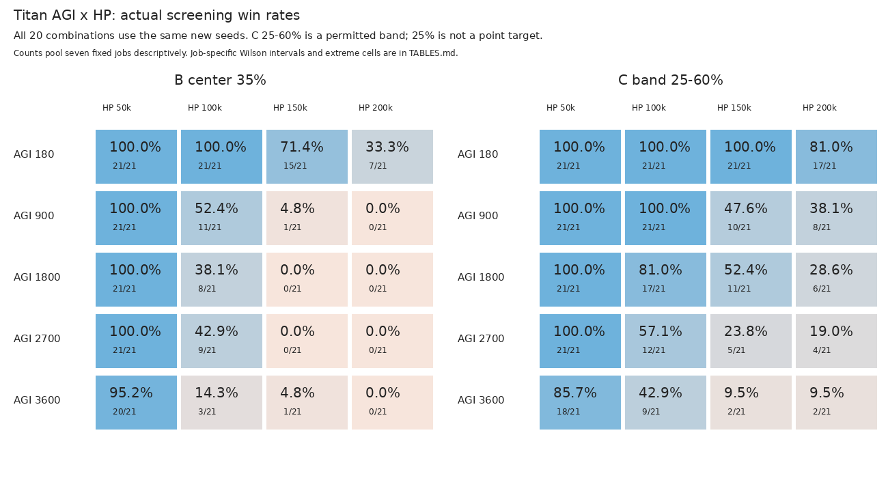
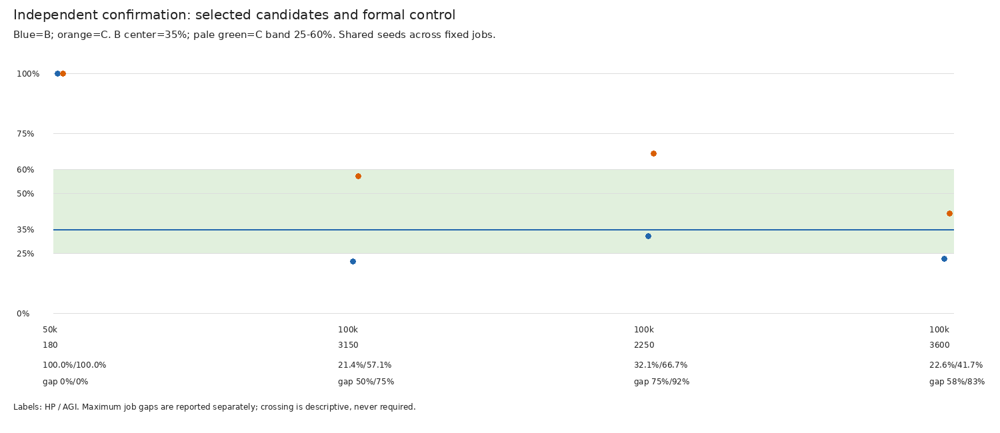
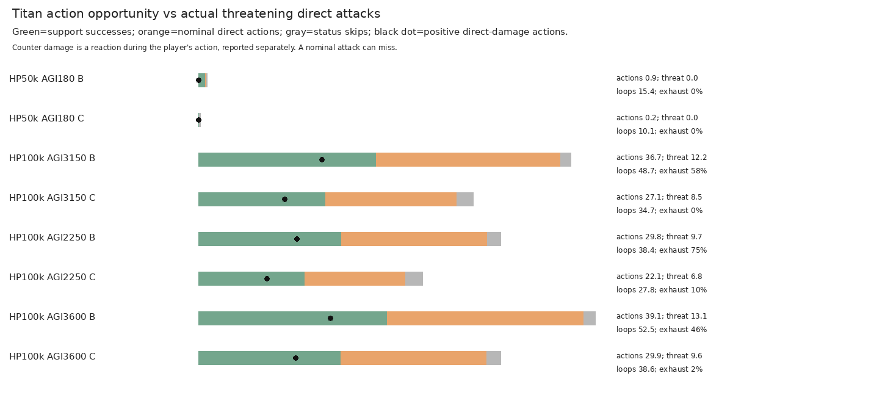

# Qhymia ボスバランス Stage 6-C

2026-11-20（JST）。8階タイタンのAGI×HP複合検証。正式値・技能構成・プレイヤー条件は変更していない。

**全20組の格子、中間4点、独立12seedでの3候補確認を完了した。パイロットを含む計2,012戦で、例外・欠測・引き分け・1,000ループ上限は0。平均勝率が目標に近い探索候補は得られたが、独立確認ではC上限超過またはB中心からの隔たりがあり、全敗職・大きな職業差も残った。正式採用できる候補は確認できていない。**

全577テスト成功。作業ブランチ`feature/boss-balance-stage6c`、開始/終了HEAD`28a2d22`。Stage 6-A/B、未追跡ファイル、バックアップ、ゲーム本体、通常DBを保持し、commit/push/mainマージ・正式値反映・Stage 6-Dの構成試験は実施していない。

## 結論：指定された5点

1. **AGI×HPだけでB/C目標を満たす候補が見つかったか：両立を確認できていない。** 独立確認でB中心35%に最も近いHP100,000/AGI2,250はB32.1%・C66.7%。C許容帯に入るAGI3,150/3,600ではB21.4%/22.6%。有限の探索結果であり、未測定の全連続値まで「不可能」とは断定しない。
2. **職業間格差を改善できたか：目標と両立する改善は未確認。** 独立確認の3候補すべてでプリーストB0/12。AGI3,600は重戦士B・プリーストCも0/12。C最大差は75.0〜91.7pt。
3. **攻撃機会と戦闘の長さは適切か：攻撃機会不足は改善したが、枯渇との両立が課題。** 3候補の全504戦で攻撃スキルへ到達した一方、Bの全技能枯渇は46.4〜75.0%。全体上限到達はなくても、適正な長さと確定できない。
4. **スキル構成見直しが必要そうか：次段階で検証する理由がある。** 開幕3補助、初攻撃スキルが平均ほぼ5行動目、約半数を占める補助行動、実被弾時の防御重複0件を確認した。構成変更が改善する効果は今回未測定。
5. **Stage 6-Dで最初に調べる問題：開幕3補助と自身行動での効果切れ。** HP/AGIを固定して、攻撃を前へ置く対照試験で初攻撃到達、被弾時の防御被覆、反撃依存、職業差がどう変わるかを見る。今回スキル順序や種類は一度も変更していない。

## 成果物

|内容|保存先|
|---|---|
|実行/観測/集計/全戦検証スクリプト|[run.py](run.py) / [observe.py](observe.py) / [analyze.py](analyze.py) / [check.py](check.py)|
|検証用自動テスト・結果|[8件のDjangoテスト](../../../apps/battle/test_balance_stage6c.py) / [test_results.json](test_results.json)|
|全試行JSONL|[pilot 80戦](pilot/runs.jsonl) / [screen 840戦](screen/runs.jsonl) / [refine 420戦](refine/runs.jsonl) / [confirm 672戦](confirm/runs.jsonl)|
|全プロフィール・戦術・seed・指紋|[screen manifest](screen/manifest.json) / [refine manifest](refine/manifest.json) / [confirm manifest](confirm/manifest.json)|
|正式12ボス・全35技能の実値|[official_catalog.json](confirm/official_catalog.json)|
|正式カタログ前後一致|[pilot](pilot/official_catalog_unchanged.json) / [screen](screen/official_catalog_unchanged.json) / [refine](refine/official_catalog_unchanged.json) / [confirm](confirm/official_catalog_unchanged.json)|
|事前計画・時間上限・新規seed確認|[initial_plan.json](initial_plan.json) / [screen_plan_final.json](screen_plan_final.json) / [refine_plan.json](refine_plan.json) / [confirm_plan.json](confirm_plan.json)|
|実測からの中間値選択・独立確認選択|[selection.json](selection.json) / [confirm_selection.json](confirm_selection.json)|
|各職業・戦術の勝率と行動/回復指標|[screen_conditions.csv](analysis/screen_conditions.csv) / [refine_conditions.csv](analysis/refine_conditions.csv) / [confirm_conditions.csv](analysis/confirm_conditions.csv)|
|候補別比較・最有力候補比較|[screen_candidates.csv](analysis/screen_candidates.csv) / [refine_candidates.csv](analysis/refine_candidates.csv) / [confirm_candidates.csv](analysis/confirm_candidates.csv) / [CANDIDATES.md](analysis/CANDIDATES.md)|
|Wilson95%・同seedの反転・正式値との差|[全職業表](analysis/TABLES.md) / [confirm_comparisons.csv](analysis/confirm_comparisons.csv)|
|AGI×HPヒートマップ|[PNG](analysis/agi_hp_heatmaps.png) / [SVG](analysis/agi_hp_heatmaps.svg)|
|B/C比較グラフ|[全20組PNG](analysis/screen_bc.png) / [SVG](analysis/screen_bc.svg)、[独立確認PNG](analysis/confirm_bc.png) / [SVG](analysis/confirm_bc.svg)|
|行動・脅威攻撃・補助・枯渇のグラフ|[PNG](analysis/confirm_combat.png) / [SVG](analysis/confirm_combat.svg)|
|同seedの相互作用（差の差）|[全戦の4点対応](analysis/interaction_runs.csv) / [24組の集計](analysis/interactions.csv)|
|最初の5行動・技能試行理由・実損傷|[最初の5行動の頻度](analysis/first_five_sequences.csv) / [全職業の試行](analysis/skill_attempts.csv) / [確認の技能別集計](analysis/confirm_skill_attempt_totals.csv)|
|補助効果の実持続・重複・回復消費|[全効果区間](analysis/confirm_effect_windows.csv) / [持続集計](analysis/confirm_effect_lifetimes.csv) / [行動/満タン回復集計](analysis/confirm_skill_actions.csv)|
|Stage 6-D引継ぎ|[STAGE6D_SKILL_HANDOFF.md](analysis/STAGE6D_SKILL_HANDOFF.md)|
|集計JSON・ソース指紋・全試行照合|[results.json](analysis/results.json) / [source_sha256.json](analysis/source_sha256.json) / [validation_final.json](validation_final.json)|
|既存ファイル保持の基準|[before.json](before.json)|

JSONLには全行動・HP台帳・MP/ST・残回数・状態異常に加え、選択スキルの試行理由、発動直後/行動終了後の効果、各HP変化時の有効効果を保存した。生データを省略した代表戦だけの分析ではない。

## 固定した条件

Stage 6-Aの新成長Ver.2プロフィールをStage 6-Bの入口で照合し、8階の7職を再利用した。B/Cは同じキャラクターで、職業・ヒューマン・Lv・回帰・F+5装備・永久習得10種と履歴・戦術/回数・育成seed20261116・属性ウェイト全1・ST100開始を固定。`legacy_reincarnation_points=0`。新戦闘力を揃え直す育成や装備調整は行っていない。

|職業|Lv|回帰|戦闘開始HP|戦闘開始MP|表示戦闘力|
|---|---:|---:|---:|---:|---:|
|拳闘士|96|198|10,372|3,817|28,199|
|重戦士|30|201|9,373|3,497|26,147|
|狩人|99|198|9,996|3,991|28,037|
|ウィザード|78|199|9,766|4,065|27,595|
|プリースト|5|202|9,190|3,568|25,142|
|放浪人|96|198|10,372|3,817|28,199|
|暗殺者|99|198|9,996|3,991|28,037|

職業ごとのLvや新戦闘力の違いも6-Aから引き継いだ評価条件であり、今回の調整効果ではない。高回帰・低Lvの評価例を新しい正式推奨育成経路とみなさない。

タイタンは正式HP50,000/AGI180を対照とし、MP4,600・STR950・INT470・DEX600・VIT3,100・LUK380・岩属性・最大ST310とその他全フィールドを固定した。技能順序は`steel_body → solid_stance → counter_stance → shock_wave → true_fist`、各99回。性能/発動率/使用制限を変更していない。

専用PostgreSQLテストDBから全12ボス・35技能を読み取り、6-A/Bカタログと一致を確認した。候補は認可済みDBから取得したEnemyのメモリ上コピーのみ。通常DBへの保存・migrationはなく、正式Enemy/Skillにも保存していない。戦闘中は既存のSELECT以外禁止、育成再照合は全SQL禁止を維持した。

## 段階と実行規模

最初の格子は指定どおりAGI180/900/1,800/2,700/3,600 × HP50,000/100,000/150,000/200,000の20組。正式値・単独変更・複合変更をすべて同じ新規seed集合で実戦測定した。

|段階|範囲|各職業/戦術のseed数|戦闘数|戦闘seed|予測（準備込み）|実戦闘|破棄込み実経過|
|---|---|---:|---:|---|---:|---:|---:|
|pilot|全20組×重戦士/プリースト×B/C|1|80|31061120|104.475秒|23.147秒|31.093秒|
|screen|全20組×全7職×B/C|3|840|32061120〜32061122|606.905秒|219.885秒|238.971秒|
|refine|中間4点＋正式値/比較基準|5|420|33061120〜33061124|283.178秒|127.273秒|136.832秒|
|confirm|3候補＋正式値×全7職×B/C|12|672|34061120〜34061131|504.594秒|162.668秒|169.922秒|

開始前に過去22個の`runs.jsonl`を走査してseed重複なしを確認した。4段階間もseed集合を分離した。pilotや選択用標本を主評価の独立確認へ加算しない。

パイロットから同条件の実測最大×2を優先して時間を見積もり、未測定職は同組合せのpilot最大×2を使った。初期の過去時間だけによる全5seed予測は約991秒で、pilot後も5seedは上限を超えた。全条件を均等に3seedへ縮小しても予測約607秒だったため、最初の600秒上限をscreenだけ660秒へ変更した。[最初のscreen計画](screen_plan.json)も保持し、3seed未満や条件間引きにはしていない。最初の計画拒否時にはDB準備・戦闘を開始していない。

上限はpilot180秒・screen660秒・refine360秒・confirm600秒。confirmは15seed予測が上限を超えたため、全条件共通12seedを選んだ。既存ランナーの戦闘間時間判定であり、1戦やDB破棄を強制中断するハード制限ではない。全段階で未到達。

## 全20組の実測と相互作用

各セルは7職×3seedの勝/21（記述合計）。共通seedを使う異なる固定キャラであり、独立21試行として二項推定しない。職業別のWilson区間は別表に収録した。

|AGI|HP50,000 B/C|HP100,000 B/C|HP150,000 B/C|HP200,000 B/C|
|---:|---|---|---|---|
|180|21 / 21|21 / 21|15 / 21|7 / 17|
|900|21 / 21|11 / 21|1 / 10|0 / 8|
|1,800|21 / 21|8 / 17|0 / 11|0 / 6|
|2,700|21 / 21|9 / 12|0 / 5|0 / 4|
|3,600|20 / 18|3 / 9|1 / 2|0 / 2|



**単独結果の合算では複合時を説明できない。** 正式値からAGI1,800だけへ変更するとB/C各21/21、HP100,000だけへ変更しても各21/21だったが、組み合わせるとB8/21・C17/21となった。

隣接するAGI2値×HP2値の12矩形について、同じ職業・戦術・seedの4戦を対応させた。たとえばHP50,000→100,000、AGI180→900では、BのAGI効果は低HP時0pt、高HP時−47.6ptで、差の差は−47.6pt。HP100,000→150,000、AGI180→900ではCの差の差−52.4ptだった。AGI2,700→3,600、HP100,000→150,000のBでは+33.3ptとなり、効果の方向や大きさがHP帯により変わった。

504件の4点対応と24個の矩形/戦術集計を保存した。これは今回の少数seedにおける記述的な相互作用であり、有意な交互作用や全seedへの一般化を確定したものではない。HP増加と毒最大HP連動、AGIと実際の行動数・疲労・補助持続の相互関係を含む総合差である。

## 中間値と独立確認候補の選択

screenのHP100,000/AGI2,700はB9/21（42.9%）・C12/21（57.1%）で平均は近いが、B3職・Cプリーストが全敗、最大差100pt。そこで、B中心またはC上限を挟んだ隣接実測点から次の4中間点を選んだ。

|追加点|同seedで比較した根拠となる隣接点|
|---|---|
|HP75,000 / AGI2,700|HP50,000と100,000|
|HP125,000 / AGI2,700|HP100,000と150,000|
|HP100,000 / AGI2,250|AGI1,800と2,700|
|HP100,000 / AGI3,150|AGI2,700と3,600|

正式値とHP100,000/AGI2,700を併測したrefineの結果は次のとおり。

|HP / AGI|B勝/35|C勝/35|観測上の問題|
|---|---:|---:|---|
|50,000 / 180|35|35|勝率の天井|
|100,000 / 2,700|5|15|B4職、Cプリースト全敗|
|75,000 / 2,700|21|27|全敗なしだが平均は高め|
|125,000 / 2,700|0|9|B全職全敗、C魔法2職全敗|
|100,000 / 2,250|12|23|B中心に近いがC65.7%、全敗職あり|
|100,000 / 3,150|13|14|平均は近いが全敗職あり|

比較基準のHP100,000/AGI2,700は、3seedと別5seedでB42.9%→14.3%と変動した。条件やエンジンを変えた差ではない。小標本・共通seedの感度を示すため、単純に合算して勝率を固定せず、各段階を別に保存した。

追加確認は、B中心距離＋C帯外距離を参照し、最良候補から20pt以内の候補だけで、全敗職・最大格差、全技能枯渇・脅威攻撃到達を別に比較して3点を選択した。C25〜60%はどの位置でも帯外距離0、34%参考線やB>Cに加点していない。順位は探索用で、正式採用の自動判定ではない。HP100,000でAGI3,150（率）・2,250（職業差）・3,600（枯渇/攻撃到達の比較）を残した。

## 独立12seedの確認結果

各B/Cは7職×12戦＝84戦の記述合計。主結論はこの独立標本を使う。

|HP|AGI|B 勝/84・率|B中心35%との差|C 勝/84・率|C許容帯|B−C|最大差B/C|
|---:|---:|---|---:|---|---|---:|---|
|50,000|180|84/84・100%|+65.0pt|84/84・100%|上限+40.0pt|0.0pt|0.0/0.0pt|
|100,000|3,150|18/84・21.4%|−13.6pt|48/84・57.1%|帯内の点推定|−35.7pt|50.0/75.0pt|
|100,000|2,250|27/84・32.1%|−2.9pt|56/84・66.7%|上限+6.7pt|−34.5pt|75.0/91.7pt|
|100,000|3,600|19/84・22.6%|−12.4pt|35/84・41.7%|帯内の点推定|−19.0pt|58.3/83.3pt|



AGI3,150と3,600のCを25%へ近づける必要はない。C帯内であることは同等に評価するが、B中心からの差と職業差は別に残る。B>Cの交差はどの複合候補にも出なかったが、それだけを不合格理由にしていない。

### 7職業の勝数（各12戦）

|職業|AGI3,150 B/C|AGI2,250 B/C|AGI3,600 B/C|
|---|---|---|---|
|拳闘士|5 / 8|8 / 8|7 / 5|
|重戦士|1 / 3|1 / 5|0 / 1|
|狩人|2 / 10|4 / 10|1 / 7|
|ウィザード|2 / 6|1 / 9|2 / 2|
|プリースト|0 / 1|0 / 1|0 / 0|
|放浪人|6 / 10|9 / 11|7 / 10|
|暗殺者|2 / 10|4 / 12|2 / 10|

全候補でプリーストB0/12。AGI2,250はCがプリースト1/12〜暗殺者12/12に分かれ、平均だけでは見落とす91.7pt差がある。AGI3,150のC57.1%も、プリースト8.3%から複数職83.3%までの差を含む。正式値の職業差0は全職全勝という天井によるもので、適正な格差の証明ではない。

Wilson95%は全職業セルに保存した。0/12は約0〜24.2%、12/12は約75.8〜100%。多重比較補正なし、育成seed1つ・固定7プロフィールという範囲の検証である。7職合計を独立84試行として区間計算せず、12seedから難易度適合や普遍的な職業格差を確定しない。

同じ12seedの正式値は全勝のため、対照勝→候補負はAGI3,150でB66/C36件、2,250でB57/C28件、3,600でB65/C49件。逆向きは0件。各seedと勝者の変化はCSVに収録した。

## 行動・回復・長期戦の内容

HPは複合候補すべて100,000。値は1戦平均、全技能枯渇は戦闘割合、満タン消費は成功したヒーリングシールド回数が分母。

|候補|戦術|ループ|プレイヤー行動|ボス行動|直接行動|実損傷を与えた直接行動|補助行動|プレイヤー被害|実回復|全技能枯渇|
|---|---|---:|---:|---:|---:|---:|---:|---:|---:|---:|
|正式値|B|15.37|11.69|0.86|0.13|0.05|0.68|約12|約3|0%|
|正式値|C|10.14|8.10|0.23|0.01|0.00|0.10|0|0|0%|
|AGI3,150|B|48.70|19.61|36.73|18.19|12.19|17.56|11,359|2,427|58.3%|
|AGI3,150|C|34.67|15.04|27.10|12.92|8.50|12.56|7,473|0|0%|
|AGI2,250|B|38.43|21.01|29.81|14.42|9.71|14.11|10,321|1,881|75.0%|
|AGI2,250|C|27.77|16.45|22.10|9.95|6.79|10.51|7,001|0|9.5%|
|AGI3,600|B|52.48|18.82|39.13|19.42|13.06|18.61|11,945|2,690|46.4%|
|AGI3,600|C|38.58|14.65|29.86|14.35|9.62|14.08|8,370|0|2.4%|



「直接行動」は通常攻撃/衝撃波/真拳一殺の実行。「脅威直接行動」は、その行動中に通常/技能でプレイヤーHPを実際に1以上減らした行動。発動失敗時の通常攻撃は直接行動に含むが、命中失敗は脅威行動に含まない。反撃は別の反応であり、ボスの独立行動として水増ししない。

3候補の全504戦で衝撃波または真拳一殺に到達し、攻撃スキル前に倒れたタイタンは0件。正式値では0/168戦しか攻撃スキルに到達せず、全168戦でその前に倒れた。複合変更で攻撃機会の不足は解消したが、AGI3,150のBは総行動36.73のうち補助17.56、実損傷のある直接行動12.19であり、総行動数を脅威の量とはみなせない。

Stage 6-BのHP200,000単独のB平均193.35ループに比べ、今回の複合候補は約38〜52ループで決着する。ただし別seed・別HPの記述比較であり、今回の同seed差として効果量を主張しない。全技能枯渇がBの約半数〜4分の3に残り、短くなっただけで適正な戦闘時間とは断定しない。AGI3,600で枯渇が少ないことも、早期敗北が増えて使い切る前に倒れる戦闘を含むため、単独で高評価にしない。

MP不足は確認の全候補で0。枯渇はMPではなく有限の使用回数で、パッシブを除く全枠が0となった状態を数えた。Cの毒実損傷は平均AGI2,250で12,726、3,150で13,730、3,600で14,673。最大HP連動・ボス自身の行動時の毒処理も含むため、毒を使うCと他職の効率差を記録し、HP増加を一律の難化とはみなさない。

### Bの満タン回復消費

|候補|満タン時の成功使用/全成功使用|割合|実回復の平均|
|---|---:|---:|---:|
|正式値|150/151|99.3%|約3|
|HP100,000/AGI2,250|24/168|14.3%|1,881|
|HP100,000/AGI3,150|2/168|1.2%|2,427|
|HP100,000/AGI3,600|0/168|0%|2,690|

回復枠が実際の被害後に使われる割合は改善した。しかし高AGIほど被害や敗北も増えるため、満タン消費0%を適正難易度の証明にはしない。戦術Bと回復回数を変更せず観測した結果である。

## 現行5スキルの詳しい観測とStage 6-Dへの引継ぎ

### 最初の5行動と最初の攻撃

複合候補の代表的な最初の5行動は、`steel_body → solid_stance → counter_stance → shock_wave → true_fist`。AGI3,150のBでは25/84戦がこの並びで、次に多いのは最後が通常攻撃となる18/84戦。実際の試行では発動失敗の通常攻撃や状態異常skipが挟まる。各戦の最初の5行動・選択したスキル・失敗理由をJSONLへ保存した。

最初の攻撃スキル成功は到達戦平均で、AGI3,150がB5.02/C5.02行動目、2,250が5.06/4.89、3,600が5.08/5.00。最短4行動目、最長11行動目。最初の通常攻撃は発動失敗の代替で早く発生し得るため、「最初の攻撃スキル」と区別する。正式値は全戦未到達であり、未到達を0行動目として平均に入れていない。

### 各スキルの試行・成功・失敗・実損傷

例としてHP100,000/AGI3,150・Bの84戦合計を示す。成功は発動成功であり、命中や損傷の成功ではない。MP不足はすべて0。

|スキル|試行|発動成功|発動失敗|実際のプレイヤーHP損傷|
|---|---:|---:|---:|---:|
|steel_body|603|497|106|0（補助）|
|solid_stance|602|491|111|0（補助）|
|counter_stance|609|487|122|0（構え自体）|
|shock_wave|599|476|123|242,057|
|true_fist|590|456|134|487,486|

反撃による損傷は別に152,931、平均1,821/戦。`counter_stance`の発動自体が与えた損傷として二重計上しない。衝撃波/真拳の平均はそれぞれ約2,882/5,803。すべて実HP減少から記録し、過剰ダメージ表示値をそのまま足していない。他の候補・戦術・各職業の全件は技能CSVに保存した。

### 補助の持続と重複

終了まで観測できた区間では、鋼の体と盤石の構えは次の自身1行動で解除、反撃の構えは次の自身2行動で解除された。戦闘終了で追跡できない区間は打切りとして分離した。AGI3,150・Bでは鋼の体497回中495区間、盤石の構え491回中489区間、反撃の構え487回中463区間が解除まで観測できた。

AGI3,150・Bでは発動直後に複数の補助フラグが同時に立ったスナップショットが774回あった。しかし行動終了処理を経た**実際のプレイヤー直接被弾時の重複は0件**。独立確認の他候補・戦術でも0件だった。発動ログの連続だけで、複数の防御効果が同時に被弾へ作用しているとは読めない。

AGI3,150・Bの補助行動窓中に受けたプレイヤー通常/技能の実損傷は合計3,264,518、Cは3,102,156。ここでの窓は直前の非skipボス行動が補助だった区間であり、軽減前の仮想ダメージや「防御で防いだ量」ではない。各HP変化時のフラグ・残り回数も保存し、タイミングと重複を実値で確認した。

### Stage 6-Dで比較する候補（未測定・未採用）

|候補|今回の観測から調べる理由|次段階で見る項目|
|---|---|---|
|現行のスキルを維持|必ず対照として残す|同じHP/AGI/seedで比較|
|攻撃スキルを前へ置く|開幕3補助で初攻撃成功が平均ほぼ5行動目|初攻撃到達、回復前の損傷、全敗職増加の有無|
|防御の順番を変える/攻防を交互に置く|発動直後の重複が被弾時には残っていない|防御被覆、反撃、攻撃機会、技能枯渇|
|補助枠を減らす|総行動の多くが補助で、脅威直接行動は一部|同等の勝率で短期化/職業差改善があるか|
|完成済み攻撃スキルの種類を変える|衝撃波・真拳・反撃の実効損傷が異なる|命中・損傷・職業差・MPとSTの変化|

最初は**HP/AGIを固定し、現行と「攻撃を前へ置いた順序」だけを比較する**案を優先する。防御の効果時間やスキル性能を独自に変更する話とは分ける。今回これらの構成を試験投入した戦闘は0件で、改善を実証したものではない。HP/AGIだけで目標と職業差を両立できていないことから検証する価値がある、という段階である。

## 検証と保護

|確認|結果|
|---|---|
|専用テスト|8件成功、3.636秒|
|全体テスト|577件成功、109.000秒、終了コード0、skip/期待失敗なし|
|全戦整合性|2,012件の一意case/seed、プロフィール・HP/ST・技能試行/成功/失敗が一致|
|正式値|全4段階で12ボス/35技能の前後一致|
|ソース|screen/refine/confirmと終了時の実測ソース指紋一致|
|旧ファイル|開始738件のうちAGENTS追記以外を指紋照合、削除0|

専用テストでは20組の直積・3/5seed均等条件・固定キャラ/戦術、HP/AGI以外の変更拒否、技能順序の変更拒否、登録外の中間値拒否を検証した。詳細観測あり/なしの同seed digest・最終値・乱数状態の一致、メモリ上コピーと正式レコードの非変更、試行理由/発動成功数/実持続/HP時点の効果状態の対応も確認した。C帯内を25%寄りに優遇しない採点と、遠い全勝候補へ格差だけでフォールバックしない選択も検証した。

初回6テスト後に統計/選択契約2件を追加したためpilotと本測定の全体指紋にはテスト追加分がある。pilot当時の実行コードは[run_source.py](pilot/run_source.py)へ保持した。pilot後のrun.py変更はscreen上限600→660秒と計画出力先の分離で、戦闘本体・観測コードの変更はない。既存Stage 6-A/Bを再集計・上書きしていない。

変更は検証専用スクリプト・テスト・成果物・本報告とAGENTSの到達点追記のみ。QHYMIA_CONTEXTの追記候補は「2026-11-20、8階AGI×HP20組＋中間4点と独立12seed確認を完了。平均と職業差の両立は未確認。Stage6-Dの構成比較を提案するが未実施。正式値未変更。詳細は本資料」とする。

### 再実行と復元

未使用出力先を使う。新しいscreen/refineの結果を確認してから独立確認へ進み、古い候補選択を別の条件へ無条件に流用しない。

```bash
venv/bin/python docs/変更詳細/balance_stage6c/run.py plan --output /tmp/qhymia-stage6c-rerun
venv/bin/python docs/変更詳細/balance_stage6c/run.py pilot --output /tmp/qhymia-stage6c-rerun
venv/bin/python docs/変更詳細/balance_stage6c/run.py screen --output /tmp/qhymia-stage6c-rerun
venv/bin/python docs/変更詳細/balance_stage6c/run.py select --output /tmp/qhymia-stage6c-rerun
venv/bin/python docs/変更詳細/balance_stage6c/run.py refine --output /tmp/qhymia-stage6c-rerun
venv/bin/python docs/変更詳細/balance_stage6c/run.py confirm --output /tmp/qhymia-stage6c-rerun
venv/bin/python docs/変更詳細/balance_stage6c/analyze.py --source /tmp/qhymia-stage6c-rerun --output /tmp/qhymia-stage6c-rerun/analysis
venv/bin/python manage.py test apps.battle.test_balance_stage6c --noinput
```

今回の追加ファイル・専用ディレクトリを個別に退避し、AGENTSのStage6-C追記だけを戻せば今回分を作業木から外せる。元からあった未追跡ファイル・Stage6-A/B・バックアップ・通常DBを巻き込む操作は行わない。復元操作自体も今回実施していない。正式実装・追加測定・スキル構成変更・commit/push/mainマージへは進まず、ここで停止する。
